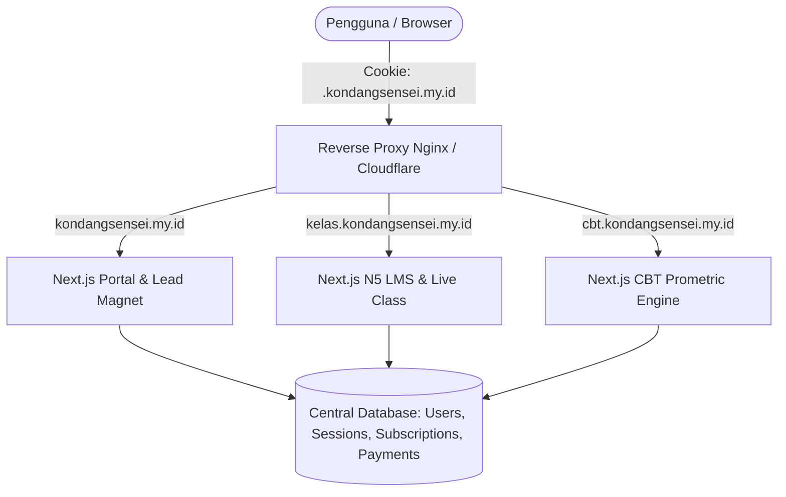

# Milestone 0: Decoupled Subdomain Topology, Shared DB, & SSO Session Management

- **Milestone ID:** `M0`
- **File Name:** `m0-architecture-sso.md`
- **Target Subdomains:** 
  - `kondangsensei.my.id` (Main Portal)
  - `kelas.kondangsensei.my.id` (N5 LMS Platform)
  - `cbt.kondangsensei.my.id` (JFT-Basic A2 CBT Engine)
- **Primary Stakeholders:** DevOps, Super Admin, All End Users
- **Dependencies:** None (Foundational Milestone)
- **Status:** Planned / Architecture Specification

---

## 1. Executive Summary & PRD Mapping
Berdasarkan PRD Seksi 1.1 (*Infrastructure & Subdomain Topology*) dan Seksi 3 Modul E.2 (*Single Sign-On & Session Management*), ekosistem KondangSensei mengadopsi arsitektur **Decoupled Subdomain** dengan **Single Centralized Database** dan **Single Sign-On (SSO)**. Pendekatan ini memisahkan beban komputasi antara portal pemasaran, interaksi LMS real-time (WebSockets/Zoom), dan engine ujian CBT Prometric yang membutuhkan performa respons instan tanpa gangguan.

---

## 2. Subdomain Topology & Routing Matrix

| Subdomain | Tanggung Jawab Utama | Tech Stack Runtime | Kebutuhan State/Session |
| :--- | :--- | :--- | :--- |
| `kondangsensei.my.id` | Main landing page, SEO portal, catalog `/kelas-n5`, lead magnet `/tryout-jft` | Next.js SSR / SSG | Anonymous & Authenticated (Cookie Token) |
| `kelas.kondangsensei.my.id` | Modul N5 Interaktif, Live Zoom SDK, Real-time Gradebook, Chat, Submission | Next.js SPA / React + WebSocket | Authenticated (Roles: `siswa_n5`, `sensei`, `super_admin`) |
| `cbt.kondangsensei.my.id` | Engine Ujian JFT-Basic A2, Chōkai Audio player lock, Timer Prometric, Scoring | Next.js Isolated SPA | Authenticated (Roles: `peserta_jft`, `super_admin`) |

---

## 3. Centralized Database Architecture

Semua subdomain terhubung ke satu pangkalan data terpusat (MySQL 8 / PostgreSQL 15).



### 3.1 Skema Inti Autentikasi & Akun (`users`, `user_roles`, `user_sessions`)
- **`users`**:
  - `id`: UUID (Primary Key)
  - `name`: VARCHAR(150)
  - `email`: VARCHAR(191) UNIQUE
  - `whatsapp_number`: VARCHAR(20) UNIQUE
  - `password_hash`: VARCHAR(255)
  - `avatar_url`: VARCHAR(255) NULL
  - `created_at`, `updated_at`: TIMESTAMP
- **`user_roles`**:
  - `id`: INT AUTO_INCREMENT
  - `user_id`: UUID (Foreign Key -> `users.id`)
  - `role`: ENUM(`super_admin`, `sensei`, `siswa_n5`, `peserta_jft`)
  - `status`: ENUM(`active`, `suspended`, `graduated`)
  - `valid_until`: TIMESTAMP NULL (untuk langganan berbatas waktu)
- **`refresh_tokens`**:
  - `id`: UUID
  - `user_id`: UUID
  - `token_hash`: VARCHAR(255)
  - `device_info`: VARCHAR(255)
  - `expires_at`: TIMESTAMP

---

## 4. Single Sign-On (SSO) & Cross-Subdomain Session Protocol

### 4.1 Cookie Domain Shared Scoping
Agar autentikasi berlaku di seluruh subdomain tanpa meminta login ulang:
- **Cookie Name:** `ks_session_token`
- **Domain:** `.kondangsensei.my.id` (dimulai dengan titik agar berlaku di root dan seluruh subdomain)
- **Attributes:**
  - `HttpOnly: true` (mencegah pencurian XSS)
  - `Secure: true` (hanya HTTPS)
  - `SameSite: Lax` (memungkinkan navigasi top-level antar subdomain tanpa kehilangan sesi)
  - `Path: /`

### 4.2 Token Payload & Verifikasi
- Token autentikasi menggunakan format JWT (atau Sanctum token hash) yang berisi:
  ```json
  {
    "sub": "usr_9b1deb4d-3b7d-4bad-9bdd-2b0d7b3dcb6d",
    "name": "Budi Pratama",
    "email": "budi@example.com",
    "roles": ["siswa_n5", "peserta_jft"],
    "iss": "auth.kondangsensei.my.id",
    "aud": "kondangsensei.my.id",
    "exp": 1730419200
  }
  ```
- Middleware di setiap Next.js app (`kondangjft`, `kelas`, `cbt`) memvalidasi cookie `ks_session_token`:
  - Jika token valid & memiliki role yang sesuai: Izinkan akses.
  - Jika token tidak ada: Redirect ke portal login terpusat (`kondangsensei.my.id/auth/login?redirect=...`).
  - Jika role tidak memiliki izin (misal: `peserta_jft` mencoba masuk ke `kelas.kondangsensei.my.id` tanpa paket N5): Redirect ke halaman katalog penawaran paket N5.

---

## 5. Security & Edge Case Handling
1. **Cross-Origin Resource Sharing (CORS):**
   - API endpoints mengizinkan origin terdaftar: `https://kondangsensei.my.id`, `https://kelas.kondangsensei.my.id`, `https://cbt.kondangsensei.my.id`.
   - Mengaktifkan `Access-Control-Allow-Credentials: true`.
2. **Session Invalidation (Global Logout):**
   - Ketika user menekan tombol "Logout" di domain manapun, endpoint `/api/auth/logout` menghapus cookie domain `.kondangsensei.my.id` dan mencabut `refresh_token` di database, sehingga seluruh sesi di semua subdomain terputus seketika.
3. **Environment Switcher (Localhost vs Production):**
   - Saat di local environment, cookie domain disesuaikan menjadi `localhost` tanpa titik awalan.

---

## 6. Implementation Checklist & Acceptance Criteria
- [ ] Konfigurasi reverse proxy Nginx / Cloudflare DNS wildcard `*.kondangsensei.my.id`.
- [ ] Implementasi shared cookie auth helper di `src/lib/authCookie.ts` dengan domain `.kondangsensei.my.id`.
- [ ] Database migration untuk tabel `users`, `user_roles`, dan `refresh_tokens`.
- [ ] Global middleware verifikasi sesi dan validasi RBAC per subdomain.
- [ ] Tes login di `kondangsensei.my.id` -> Otomatis terotentikasi saat membuka `kelas.kondangsensei.my.id` dan `cbt.kondangsensei.my.id`.
- [ ] Tes logout di satu subdomain -> Sesi di seluruh subdomain lain langsung hangus.
