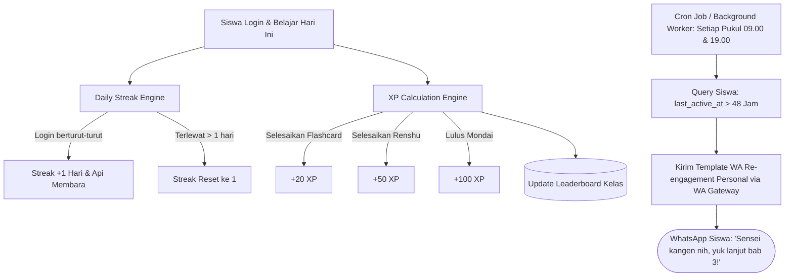

# Milestone 10: Daily Streak, XP Engine, Leaderboard, & WhatsApp Re-engagement Automation

- **Milestone ID:** `M10`
- **File Name:** `m10-gamification-streak-whatsapp.md`
- **Target Subdomain:** `kelas.kondangsensei.my.id` (N5 LMS Platform)
- **Primary Stakeholders:** Siswa N5, Sensei, Customer Retention Team
- **Dependencies:** `M0` (Shared DB), `M1` (User Roles)
- **Status:** Planned / Architecture Specification

---

## 1. Executive Summary & PRD Mapping
Berdasarkan PRD Seksi 3 Modul B.1 (*Daily Streak & Point System*), Modul B.2 (*Integrasi Pengingat WhatsApp Automation*), dan Modul C Tahap 1 (*Pre-Class Student Journey*):
KondangSensei menerapkan mesin gamifikasi untuk memaksimalkan retensi harian siswa dan mencegah angka putus belajar (*drop-out*).

Fitur utama:
1. **Daily Streak Counter:** Menghitung runtutan hari berturut-turut siswa aktif belajar di portal.
2. **XP & Leveling System:** Akumulasi poin pengalaman (XP) otomatis saat menyelesaikan materi Bunpou, latihan Flashcard, Renshu, dan ujian Mondai.
3. **Class Leaderboard:** Peringkat kelas berbasis XP mingguan/bulanan untuk memicu kompetisi positif.
4. **Automated WhatsApp Re-engagement:** Cron scheduler yang mendeteksi ketidakaktifan siswa $\ge 2$ hari dan mengirimkan pesan motivasi via WhatsApp Gateway resmi.

---

## 2. Gamification & Re-engagement Architecture



---

## 3. Data Schema & Gamification Tables

```sql
CREATE TABLE user_gamification (
    id VARCHAR(36) PRIMARY KEY,
    user_id VARCHAR(36) UNIQUE NOT NULL,
    current_streak INT DEFAULT 0,
    longest_streak INT DEFAULT 0,
    last_active_date DATE NULL,
    total_xp INT DEFAULT 0,
    level INT DEFAULT 1,
    created_at TIMESTAMP DEFAULT CURRENT_TIMESTAMP,
    updated_at TIMESTAMP DEFAULT CURRENT_TIMESTAMP ON UPDATE CURRENT_TIMESTAMP,
    FOREIGN KEY (user_id) REFERENCES users(id) ON DELETE CASCADE
);

CREATE TABLE xp_history (
    id VARCHAR(36) PRIMARY KEY,
    user_id VARCHAR(36) NOT NULL,
    xp_amount INT NOT NULL,
    source_type ENUM('daily_login', 'bunpou_read', 'srs_review', 'renshu_solve', 'mondai_pass', 'kaku_approved') NOT NULL,
    reference_id VARCHAR(36) NULL,
    awarded_at TIMESTAMP DEFAULT CURRENT_TIMESTAMP,
    FOREIGN KEY (user_id) REFERENCES users(id)
);

CREATE TABLE whatsapp_reminders_log (
    id VARCHAR(36) PRIMARY KEY,
    user_id VARCHAR(36) NOT NULL,
    phone_number VARCHAR(20) NOT NULL,
    template_type ENUM('inactive_2_days', 'inactive_5_days', 'upcoming_zoom_class') NOT NULL,
    message_content TEXT NOT NULL,
    sent_status ENUM('success', 'failed') NOT NULL,
    gateway_response_id VARCHAR(100) NULL,
    sent_at TIMESTAMP DEFAULT CURRENT_TIMESTAMP,
    FOREIGN KEY (user_id) REFERENCES users(id)
);
```

---

## 4. Business Logic & WhatsApp Automation

### 4.1 Daily Streak Calculation Logic
Dipanggil saat siswa pertama kali mengakses dashboard setiap hari:
- Misal tanggal sekarang = $D_{today}$, tanggal terakhir aktif = $D_{last}$.
- Jika $D_{last} == D_{today}$: Tidak ada perubahan streak (sudah tercatat hari ini).
- Jika $D_{last} == D_{today} - 1$: `current_streak += 1`. Update `longest_streak = max(longest_streak, current_streak)`. Berikan bonus login `+10 XP`.
- Jika $D_{last} < D_{today} - 1$: Streak terputus! `current_streak = 1`.

### 4.2 Automated WhatsApp Re-engagement Worker
- **Jadwal Eksekusi:** Cron job berjalan setiap hari pukul 09:30 WIB.
- **Kondisi Siswa yang Ditarget:**
  ```sql
  SELECT u.id, u.name, u.whatsapp_number, g.current_streak, g.last_active_date
  FROM users u
  JOIN user_gamification g ON u.id = g.user_id
  JOIN user_roles r ON u.id = r.user_id AND r.role = 'siswa_n5' AND r.is_active = TRUE
  WHERE g.last_active_date <= DATE_SUB(CURDATE(), INTERVAL 2 DAY)
    AND NOT EXISTS (
      SELECT 1 FROM whatsapp_reminders_log w 
      WHERE w.user_id = u.id AND w.sent_at >= DATE_SUB(NOW(), INTERVAL 48 HOUR)
    );
  ```
- **Template Pesan WhatsApp:**
  > *"Halo {{nama_siswa}} san! 🌸*
  > *Sensei perhatikan kamu sudah 2 hari belum latihan di KondangSensei nih. Daily streak kamu sayang banget kalau reset!*
  > *Yuk buka kelas sebentar dan selesaikan 5 kartu kosakata hari ini di: https://kelas.kondangsensei.my.id*
  > *Ganbatte kudasai! 💪"*

---

## 5. UI/UX Specifications
- **Streak Flame Indicator:** Ikon api membara di header dengan angka runtutan hari (animasi denyut saat streak aktif hari ini).
- **XP Progress Bar:** Bilah kemajuan menuju level berikutnya (misal: "Level 3 - Pemula Bersemangat: 450/600 XP").
- **Leaderboard Widget:** Menampilkan peringkat 10 besar siswa sekelas dengan medali emas, perak, perunggu, dan penanda sorotan pada baris posisi akun siswa yang sedang login.

---

## 6. Implementation Checklist & Acceptance Criteria
- [ ] Database migration tabel `user_gamification`, `xp_history`, dan `whatsapp_reminders_log`.
- [ ] Endpoint `POST /api/gamification/heartbeat` untuk mencatat aktivitas harian dan pembaruan streak.
- [ ] Komponen UI `DailyStreakBadge.tsx`, `XPProgressBar.tsx`, dan `ClassLeaderboard.tsx`.
- [ ] Service integrasi WhatsApp Gateway API (Fonnte / Waba / Twilio) di `src/lib/whatsappGateway.ts`.
- [ ] Command runner / Cron job `scripts/cronWhatsAppReminder.ts` untuk memeriksa ketidakaktifan siswa $\ge 2$ hari.
- [ ] Pengujian automated WA dispatch: pesan terkirim sesuai nomor tujuan tanpa spam ganda (idempotent 48 jam).
