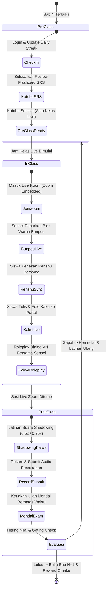

# Milestone 12: Flipped Classroom Orchestrator & Student Journey State Machine

- **Milestone ID:** `M12`
- **File Name:** `m12-flipped-classroom-workflow.md`
- **Target Subdomain:** `kelas.kondangsensei.my.id` (N5 LMS Platform)
- **Primary Stakeholders:** Siswa N5, Sensei, Curriculum Director
- **Dependencies:** `M4`, `M5`, `M6`, `M7`, `M8`, `M9`, `M10`
- **Status:** Planned / Architecture Specification

---

## 1. Executive Summary & PRD Mapping
Berdasarkan PRD Seksi 3 Modul C (*Student Journey & Flipped Classroom Workflow*):
Platform tidak membiarkan siswa belajar secara acak atau pasif. Seluruh aktivitas belajar dikelompokkan ke dalam metodologi **Flipped Classroom 3 Tahap**:
1. **Tahap 1: Persiapan Mandiri (Pre-Class):** Siswa login mandiri, memicu streak, mempelajari kartu kosakata SRS sebelum jam kelas.
2. **Tahap 2: Sesi Kelas Live (In-Class / Zoom Embedded):** Sinkronisasi interaktif langsung dengan Sensei (Presentasi Blok Warna Bunpou, Pengerjaan Simultan Renshu, Upload Cepat Kaku, dan Latihan Percakapan Live Kaiwa).
3. **Tahap 3: Penugasan & Evaluasi (Post-Class):** Latihan mandiri intonasi Shadowing, pengumpulan rekaman suara, dan penutupan dengan ujian Mondai berbatas waktu untuk membuka bab berikutnya.

---

## 2. Flipped Classroom State Machine Diagram



---

## 3. Data Schema & Chapter Journey Tracking

```sql
CREATE TABLE chapter_journey_states (
    id VARCHAR(36) PRIMARY KEY,
    user_id VARCHAR(36) NOT NULL,
    chapter_id INT NOT NULL,
    current_stage ENUM('pre_class', 'in_class', 'post_class', 'completed') DEFAULT 'pre_class',
    pre_class_srs_completed BOOLEAN DEFAULT FALSE,
    in_class_attendance BOOLEAN DEFAULT FALSE,
    in_class_renshu_score INT NULL,
    in_class_kaku_submitted BOOLEAN DEFAULT FALSE,
    post_class_audio_submitted BOOLEAN DEFAULT FALSE,
    post_class_mondai_passed BOOLEAN DEFAULT FALSE,
    stage_started_at TIMESTAMP DEFAULT CURRENT_TIMESTAMP,
    completed_at TIMESTAMP NULL,
    FOREIGN KEY (user_id) REFERENCES users(id),
    UNIQUE(user_id, chapter_id)
);
```

---

## 4. UI/UX: Interactive Student Stepper Dashboard
Di dashboard siswa `kelas.kondangsensei.my.id`, tampilan navigasi bab disajikan sebagai **3-Stage Visual Stepper**:
- **Tab 1: 🟡 Pre-Class (Persiapan Mandiri):**
  - Checkbox interaktif: Kotoba SRS Checklist ($X / Y$ kartu diselesaikan hari ini).
  - Countdown waktu menuju sesi kelas Zoom terdekat.
- **Tab 2: 🔵 In-Class (Ruang Kelas Langsung):**
  - Tombol "Masuk Ruang Kelas Zoom" (aktif 15 menit sebelum jadwal kelas).
  - Tombol pintas cepat ke papan Renshu dan unggah foto Kaku saat guru memberikan aba-aba di Zoom.
- **Tab 3: 🟢 Post-Class (Ujian & Rekaman):**
  - Panel tugas rekaman audio Kaiwa.
  - Kartu Mondai Exam dengan peringatan batas kelulusan $\ge 75\%$.

---

## 5. Sensei Class-Flow Controller
Di sisi guru (*Teacher Dashboard*), Sensei memiliki tombol kontrol panggung (*Stage Switcher*):
- `"Aktifkan Mode Renshu Simultan"`: Memicu notifikasi *pop-up* di layar seluruh siswa sekelas untuk langsung membuka soal Renshu yang sedang dibahas.
- `"Buka Sesi Upload Kaku"`: Membuka jendela waktu 5 menit bagi siswa untuk memotret buku tulis dan mengirimkannya ke sistem.

---

## 6. Implementation Checklist & Acceptance Criteria
- [ ] Database migration tabel `chapter_journey_states`.
- [ ] Komponen React `FlippedClassroomStepper.tsx` yang secara otomatis menandai status centang hijau pada tahap yang telah rampung.
- [ ] Logika transisi status otomatis ketika event `srs_completed`, `kaku_submitted`, dan `mondai_passed` terjadi.
- [ ] Integrasi sinyal pemicu dari Teacher Dashboard ke layar siswa untuk latihan simultan.
- [ ] Pengujian skenario lengkap: Siswa tidak bisa melewati tahap Post-Class Mondai sebelum menyelesaikan persiapan dasar.
