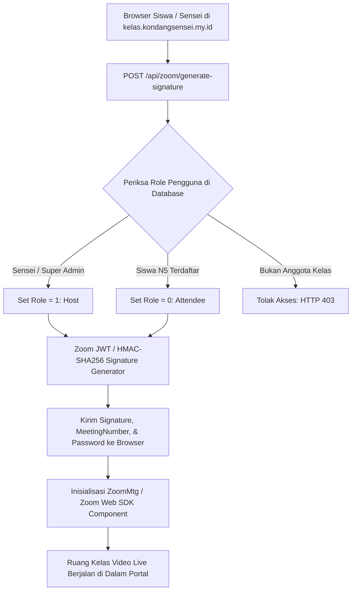

# Milestone 13: Embedded Zoom Web SDK & In-App Live Classroom Infrastructure

- **Milestone ID:** `M13`
- **File Name:** `m13-zoom-web-sdk-integration.md`
- **Target Subdomain:** `kelas.kondangsensei.my.id` (N5 LMS Platform)
- **Primary Stakeholders:** Sensei (Host), Siswa N5 (Peserta Kelas Live)
- **Dependencies:** `M0` (Shared DB), `M1` (User Roles)
- **Status:** Planned / Architecture Specification

---

## 1. Executive Summary & PRD Mapping
Berdasarkan PRD Seksi 3 Modul D.1 (*Integrasi Zoom Web SDK*) dan Modul C Tahap 2 (*Sesi Kelas Live In-Class*):
Untuk mencegah kebocoran link pertemuan (*zoom link leakage*) dan menjaga konsentrasi belajar tanpa berpindah aplikasi, portal `kelas.kondangsensei.my.id` mengintegrasikan **Zoom Meeting Web SDK (Component View / Client View)** yang tertanam secara langsung (*fully embedded*) di dalam halaman web.

Keuntungan strategis:
- **Zero External Link:** Siswa tidak perlu mengklik tautan eksternal WhatsApp atau membuka aplikasi Zoom eksternal.
- **Unified Side-by-Side Learning:** Window video Zoom dapat berjalan berdampingan (*split view*) dengan papan Bunpou, Renshu, atau Kaku di layar peramban yang sama.
- **Strict Role Control:** Sensei otomatis terautentikasi sebagai Host (Role 1), sedangkan Siswa otomatis terdaftar sebagai Attendee (Role 0) berdasarkan session token internal.

---

## 2. Zoom Web SDK Architecture & Signature Flow



---

## 3. Signature Generation Protocol (Server-Side)
Untuk keamanan mutlak, API Key dan API Secret Zoom tidak boleh bocor ke frontend. Signature dibuat di server Next.js API route:

```typescript
// src/app/api/zoom/generate-signature/route.ts
import crypto from "crypto";

export async function POST(req: Request) {
  const session = await getAuthenticatedSession(req);
  if (!session) return jsonError("Unauthorized", 401);

  const { classId } = await req.json();
  const classData = await db.n5Class.findUnique({ where: { id: classId } });

  // Validasi keanggotaan kelas
  const isSensei = classData.senseiId === session.userId;
  const isEnrolled = await db.n5ClassMember.findUnique({
    where: { classId_studentId: { classId, studentId: session.userId } }
  });

  if (!isSensei && !isEnrolled && !session.roles.includes("super_admin")) {
    return jsonError("Anda bukan peserta kelas ini", 403);
  }

  const meetingNumber = classData.zoomMeetingId;
  const role = isSensei ? 1 : 0; // 1 = Host, 0 = Participant
  const sdkKey = process.env.ZOOM_SDK_KEY!;
  const sdkSecret = process.env.ZOOM_SDK_SECRET!;
  const iat = Math.floor(Date.now() / 1000) - 30;
  const exp = iat + 60 * 60 * 2; // Masa berlaku signature 2 jam

  const oHeader = { alg: "HS256", typ: "JWT" };
  const oPayload = {
    sdkKey: sdkKey,
    mn: meetingNumber,
    role: role,
    iat: iat,
    exp: exp,
    tokenExp: exp
  };

  const signature = createHmacJwt(oHeader, oPayload, sdkSecret);

  return NextResponse.json({
    signature,
    meetingNumber,
    password: classData.zoomPassword,
    userName: session.name,
    userEmail: session.email,
    role
  });
}
```

---

## 4. UI/UX: Side-by-Side Dual Pane Layout
Halaman kelas live (`/kelas/[classId]/live`) menggunakan tata letak layar ganda (*Dual Pane Canvas*):
- **Sisi Kiri (60% Lebar Layar):** Modul Pembelajaran Aktif (Sensei Bunpou Presentation / Renshu Practice / Kaiwa VN dialog).
- **Sisi Kanan (40% Lebar Layar / Docked Window):** Window video Zoom Web SDK yang tertanam rapi, menampilkan video guru dan rekan sekelas, audio kontrol (mute/unmute mikrofon), serta tombol angkat tangan (*raise hand*).
- **Mobile Mode:** Toggle tab atas antara "Video Sensei" dan "Papan Latihan Soal".

---

## 5. Security & Isolation Controls
1. **Pencegahan Penyusupan (Anti-Zoombombing):**
   - Meeting Password dienkripsi di pangkalan data dan tidak pernah ditampilkan secara polos kepada siswa.
   - Hanya siswa dengan status langganan aktif yang dapat meminta signature untuk meeting ID terkait.
2. **Auto-Attendance Tracking:**
   - Ketika Zoom Web SDK memicu event `onMeetingStatusChange(2)` (Connected), sistem otomatis mencatat log presensi kehadiran siswa di tabel `chapter_journey_states.in_class_attendance = TRUE`.

---

## 6. Implementation Checklist & Acceptance Criteria
- [ ] Pendaftaran aplikasi Zoom SDK di Zoom App Marketplace (Mendapatkan Client ID & Client Secret).
- [ ] Endpoint server-side `POST /api/zoom/generate-signature` dengan validasi role host vs attendee.
- [ ] Integrasi library `@zoomus/websdk` di frontend dengan isolasi CSS agar tidak merusak tema portal.
- [ ] Pembuatan komponen layout layar ganda `LiveClassroomContainer.tsx`.
- [ ] Handler presensi otomatis saat siswa berhasil terhubung ke audio/video kelas.
- [ ] Pengujian konferensi video: Sensei memulai meeting di portal, siswa join di portal tanpa membuka aplikasi Zoom desktop.
