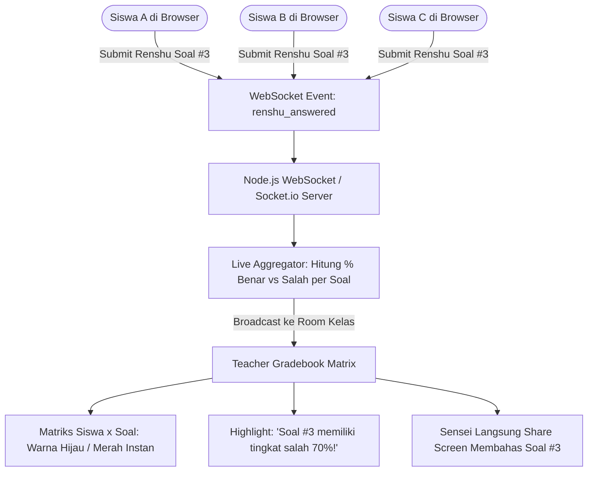

# Milestone 14: Teacher Real-Time Gradebook Matrix & Live Class Analytics

- **Milestone ID:** `M14`
- **File Name:** `m14-realtime-gradebook.md`
- **Target Subdomain:** `kelas.kondangsensei.my.id` (Teacher Portal)
- **Primary Stakeholders:** Sensei (Instruktur Kelas N5), Super Admin
- **Dependencies:** `M1` (Sensei Role Isolation), `M6` (Renshu), `M9` (Mondai)
- **Status:** Planned / Architecture Specification

---

## 1. Executive Summary & PRD Mapping
Berdasarkan PRD Seksi 3 Modul D.2 (*Real-time Gradebook*) dan Modul C Tahap 2 (*Praktek Renshu Bersama In-Class*):
Selama sesi kelas live berlangsung, Sensei membutuhkan visibilitas instan terhadap pemahaman setiap siswa. 

**Real-Time Gradebook** menyediakan matriks visual interaktif berbasis WebSocket/SSE (*Server-Sent Events*) yang memperbarui nilai dan jawaban siswa saat itu juga (*live telemetry*). Fitur ini secara otomatis menghitung **Tingkat Kesalahan Soal (Error-Rate Analytics)**, sehingga Sensei tahu persis nomor soal mana yang paling banyak membuat siswa bingung untuk segera dibahas di layar Zoom tanpa perlu bertanya satu per satu.

---

## 2. Real-Time Telemetry & Gradebook Architecture



---

## 3. WebSocket Event Specification (`class_telemetry`)
- **Room Scoping:** `class:class_{classId}` (Sensei dan maksimal 10 siswa dalam satu batch).
- **Client Emitter (Siswa):**
  ```json
  {
    "event": "student:submission",
    "payload": {
      "classId": "cls_batch1_n5",
      "studentId": "usr_budi123",
      "exerciseType": "renshu",
      "questionNumber": 3,
      "isCorrect": false,
      "timeSpentSeconds": 14
    }
  }
  ```
- **Server Broadcast ke Sensei:**
  ```json
  {
    "event": "teacher:gradebook_update",
    "payload": {
      "studentId": "usr_budi123",
      "studentName": "Budi Pratama",
      "questionNumber": 3,
      "status": "wrong",
      "liveScore": 60,
      "classSummary": {
        "question3": { "totalAnswered": 8, "wrongCount": 6, "errorRate": 75.0 }
      }
    }
  }
  ```

---

## 4. UI/UX: Real-Time Teacher Matrix Dashboard
1. **Interactive Heatmap Matrix:**
   - Baris: Nama Siswa (Maks 10 siswa per kelas).
   - Kolom: Nomor Soal 1, 2, 3, 4, 5... dst.
   - Sel Indikator:
     - ⚪ **Abu-abu:** Belum mengerjakan.
     - 🟡 **Kuning Berkedip:** Sedang mengerjakan / memilih jawaban.
     - 🟢 **Hijau Solid:** Menjawab benar.
     - 🔴 **Merah Solid:** Menjawab salah (dapat diklik untuk melihat jawaban keliru yang dipilih siswa).
2. **Top Error-Rate Alert Bar:**
   - Panel di sisi atas dasbor yang menyortir otomatis:
     > *"⚠️ Soal #4 (Partikel で vs に) salah dijawab oleh 7 dari 10 siswa. Klik di sini untuk membuka pembahasan di layar presentasi."*
3. **Mondai Final Exam Live Monitor:**
   - Menampilkan status timer ujian Mondai siswa secara live dan skor akhir sesaat setelah siswa menekan tombol "Selesai".

---

## 5. Security & Data Isolation
- Sensei **hanya** dapat berlangganan (*subscribe*) ke room WebSocket kelas yang terdaftar atas namanya di database.
- Data siswa dari kelas lain diproteksi oleh *Channel Authorization Guard*.

---

## 6. Implementation Checklist & Acceptance Criteria
- [ ] Implementasi WebSocket server / Socket.io channel di `src/lib/socketServer.ts`.
- [ ] Komponen React `TeacherGradebookMatrix.tsx` dengan pembaruan state real-time tanpa *re-render* seluruh tabel.
- [ ] Algoritma agregasi tingkat kesalahan (*Error Rate Analyzer*) per nomor soal.
- [ ] Tombol cepat Sensei: "Tampilkan Soal Ini ke Zoom" untuk membahas nomor yang paling sulit.
- [ ] Pengujian beban simultan: 10 siswa mengirim jawaban bersamaan dalam rentang 2 detik -> Tampilan layar Sensei terupdate dalam waktu < 200 ms.
