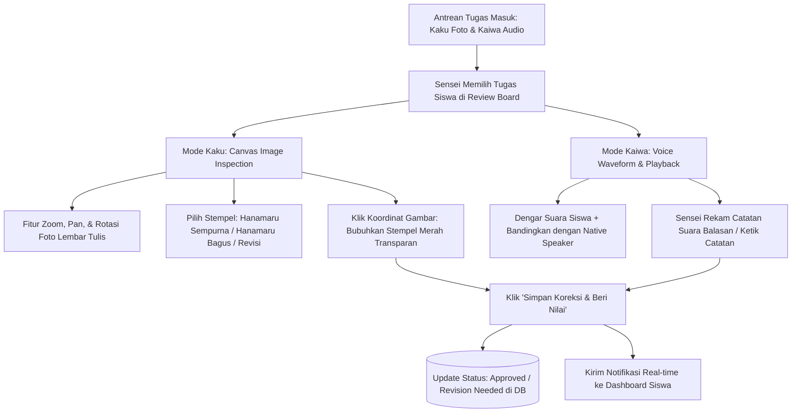

# Milestone 15: Voice/Image Review Board & Interactive Hanamaru Digital Stamp

- **Milestone ID:** `M15`
- **File Name:** `m15-review-board-hanamaru-stamp.md`
- **Target Subdomain:** `kelas.kondangsensei.my.id` (Teacher Portal)
- **Primary Stakeholders:** Sensei (Evaluator), Siswa N5 (Penerima Feedback)
- **Dependencies:** `M1` (Sensei Role Isolation), `M7` (Kaiwa Voice), `M8` (Kaku Image)
- **Status:** Planned / Architecture Specification

---

## 1. Executive Summary & PRD Mapping
Berdasarkan PRD Seksi 3 Modul D.3 (*Voice & Image Review Board*) dan Modul A.5 (*Buku PR Digital Kaku*):
Modul Review Board adalah meja kerja digital Sensei untuk memeriksa tugas-tugas non-otomatis:
1. **Audio Player Evaluator:** Memutar rekaman pelafalan Kaiwa siswa, menilai ketepatan intonasi dan kelancaran membaca.
2. **High-Res Image Viewer:** Memeriksa foto tulisan tangan Kaku dengan fitur perbesaran (*zoom*), rotasi, dan penandaan area coretan.
3. **Hanamaru Digital Stamp (はなまる):** Fitur stempel bunga spiral tradisional khas guru Jepang yang dibubuhkan pada foto tugas siswa sebagai simbol apresiasi visual yang autentik dan membakar semangat belajar.

---

## 2. Review Board Workflow & Stamp Architecture



---

## 3. Data Schema & Stamp Coordinates

```sql
CREATE TABLE homework_reviews (
    id VARCHAR(36) PRIMARY KEY,
    submission_type ENUM('kaku_image', 'kaiwa_audio') NOT NULL,
    submission_id VARCHAR(36) NOT NULL,
    sensei_id VARCHAR(36) NOT NULL,
    status ENUM('approved', 'revision_needed') NOT NULL,
    hanamaru_type ENUM('super_hanamaru', 'standard_hanamaru', 'check_mark', 'revision_stamp') NOT NULL,
    stamp_coordinates_json JSON NULL, -- Koordinat stempel di atas kanvas: {"x": 420, "y": 180, "scale": 1.2, "rotation": -5}
    written_feedback TEXT NULL,
    audio_feedback_url VARCHAR(255) NULL, -- Rekaman suara Sensei mengoreksi pelafalan
    reviewed_at TIMESTAMP DEFAULT CURRENT_TIMESTAMP,
    FOREIGN KEY (sensei_id) REFERENCES users(id)
);
```

---

## 4. Technical Specifications: Canvas Hanamaru Tool

### 4.1 Digital Stamp Graphic Engine
Stempel Hanamaru adalah ikon bunga spiral merah khas Jepang:
- **Tipe Stempel:**
  - 💮 **Super Hanamaru (大変よくできました):** Spiral ganda dengan kelopak bunga mekar penuh untuk tulisan/pelafalan sempurna.
  - 🌸 **Standard Hanamaru (よくできました):** Spiral tunggal dengan kelopak untuk tugas rapi dan benar.
  - ✏️ **Revisi (もうすこし):** Stempel segitiga/kotak merah halus menandakan perlunya perbaikan goresan.
- **Implementasi Kanvas Frontend:**
  Menggunakan HTML5 Canvas atau SVG Overlay di atas gambar foto tugas siswa. Sensei cukup mengklik titik koordinat pada lembar tulisan untuk meletakkan stempel, yang kemudian dirender permanen (*burned-in*) atau disimpan sebagai layer terpisah.

### 4.2 Voice Note Feedback Player
Sensei dapat merekam pesan suara balik hingga 30 detik untuk mencontohkan pelafalan yang benar jika ada kesalahan aksen siswa di modul Kaiwa.

---

## 5. UI/UX: Split Review Interface
- **Panel Kiri (Tampilan Berkas Siswa):**
  - Untuk tugas Kaku: Kanvas foto responsif dengan navigasi pan-and-zoom menggunakan roda mouse atau cubitan layar sentuh (*pinch-to-zoom*).
  - Untuk tugas Kaiwa: Pemutar audio dengan visualisasi waveform dan tombol berdampingan untuk mendengarkan audio penutur asli vs audio siswa.
- **Panel Kanan (Instrumen Penilaian Sensei):**
  - Palet stempel Hanamaru (pilihan 3 jenis stempel interaktif).
  - Kolom teks catatan koreksi: Rekomendasi goresan kanji / penekanan mora.
  - Tombol aksi cepat: `[ Simpan & Luluskan ]` dan `[ Minta Revisi ]`.

---

## 6. Implementation Checklist & Acceptance Criteria
- [ ] Database migration tabel `homework_reviews`.
- [ ] Komponen React `TeacherReviewBoard.tsx` dengan antrean tugas terurut FIFO.
- [ ] Komponen stempel kanvas `HanamaruCanvasViewer.tsx` dengan penempatan stempel interaktif.
- [ ] Integrasi aset grafis SVG transparan Hanamaru (*red cinnabar color: #C53030*).
- [ ] Fitur voice feedback recorder di sisi Sensei untuk tugas audio Kaiwa.
- [ ] Verifikasi tampilan di sisi siswa: Siswa dapat membuka lembar PR mereka dan melihat stempel merah Hanamaru dari Sensei bersinar di atas foto tugasnya.
