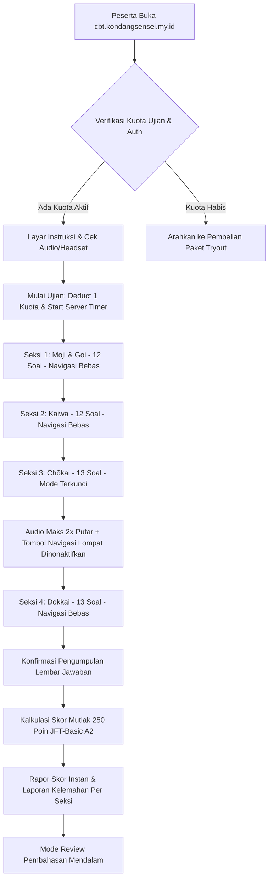

# Milestone 17: JFT-Basic A2 Prometric-Style CBT Engine & Chōkai Audio Controller

- **Milestone ID:** `M17`
- **File Name:** `m17-cbt-jft-engine.md`
- **Target Subdomain:** `cbt.kondangsensei.my.id` (Isolated Simulation Engine)
- **Primary Stakeholders:** Peserta Ujian JFT-Basic A2, Super Admin (Content & Question Bank Manager)
- **Dependencies:** `M0` (Shared DB & SSO), `M1` (Role: `peserta_jft`), `M3` (Tryout Quota Check)
- **Status:** Planned / Architecture Specification

---

## 1. Executive Summary & PRD Mapping
Berdasarkan PRD Seksi 1.1 (*Infrastructure & Subdomain Topology*), Seksi 2 (*Peserta JFT A2 Role*), dan PRD Seksi 3 (*Spesifikasi Ujian Sistem JFT-Basic*):
Subdomain `cbt.kondangsensei.my.id` menjalankan engine simulasi ujian berstandar resmi **Prometric CBT (Computer Based Test)** yang mereplikasi secara akurat antarmuka dan regulasi ujian Japan Foundation Test for Basic Japanese (JFT-Basic A2).

Spesifikasi 50 Soal & 4 Seksi:
- **Seksi 1 (S1) - Moji & Goi (Huruf & Kosakata):** 12 soal (gambar/teks).
- **Seksi 2 (S2) - Kaiwa (Percakapan & Ekspresi):** 12 soal (dialog kontekstual kerja/sosial).
- **Seksi 3 (S3) - Chōkai (Pendengaran):** 13 soal. **Regulasi Ketat:** Maksimal putar audio 2 kali, navigasi terkunci (*linear locked navigation*—tidak bisa kembali ke soal sebelumnya atau loncat nomor), dan audio tidak dapat digeser (*seek-bar disabled*).
- **Seksi 4 (S4) - Dokkai (Pemahaman Bacaan):** 13 soal (bacaan panjang & ilustrasi formulir/jadwal).

---

## 2. Prometric Exam Workflow & Anti-Cheat State Machine



---

## 3. Chōkai Audio Controller & Anti-Cheat Specifications
Sesuai regulasi resmi Prometric JFT-Basic A2:
1. **Batas Putar Audio (Play Limit = 2x):**
   - Setiap butir soal Chōkai memiliki penghitung putar (*play counter*).
   - Audio otomatis berhenti dan tombol "Play" dinonaktifkan permanen setelah pemutaran ke-2 selesai.
2. **Seekbar & Dragging Disabled:**
   - Bilah pencarian durasi (*scrubber / seekbar*) disembunyikan dan diabaikan dari input mouse/touch agar peserta tidak dapat mengulang bagian audio tertentu secara curang.
3. **Linear Forward-Only Navigation:**
   - Selama seksi Chōkai (Nomor 25 hingga 37), tombol "Sebelumnya" (*Back*) dan panel nomor navigasi di sebelah kanan disembunyikan atau dinonaktifkan.
   - Peserta **hanya** dapat mengklik tombol "Berikutnya" (*Next*), dan begitu berpindah nomor, jawaban tidak dapat diubah kembali.

---

## 4. Data Schema (`jft_exam_packages`, `jft_questions`, `jft_exam_sessions`)

```sql
CREATE TABLE jft_exam_packages (
    id VARCHAR(36) PRIMARY KEY,
    title VARCHAR(150) NOT NULL,         -- Contoh: "Simulasi JFT-Basic A2 Paket 1"
    code VARCHAR(50) UNIQUE NOT NULL,
    total_duration_minutes INT DEFAULT 60,
    passing_score INT DEFAULT 200,
    max_score INT DEFAULT 250,
    is_active BOOLEAN DEFAULT TRUE,
    created_at TIMESTAMP DEFAULT CURRENT_TIMESTAMP
);

CREATE TABLE jft_questions (
    id VARCHAR(36) PRIMARY KEY,
    package_id VARCHAR(36) NOT NULL,
    section ENUM('s1_moji_goi', 's2_kaiwa', 's3_chokai', 's4_dokkai') NOT NULL,
    question_number INT NOT NULL,        -- Urutan 1 s.d. 50
    question_text TEXT NOT NULL,
    image_url VARCHAR(255) NULL,
    audio_url VARCHAR(255) NULL,
    options_json JSON NOT NULL,          -- Array 4 opsi
    correct_option_index INT NOT NULL,   -- Index 0, 1, 2, atau 3
    explanation_text TEXT NOT NULL,      -- Pembahasan kunci jawaban
    FOREIGN KEY (package_id) REFERENCES jft_exam_packages(id) ON DELETE CASCADE
);

CREATE TABLE jft_exam_sessions (
    id VARCHAR(36) PRIMARY KEY,
    user_id VARCHAR(36) NOT NULL,
    package_id VARCHAR(36) NOT NULL,
    started_at DATETIME NOT NULL,
    finished_at DATETIME NULL,
    is_submitted BOOLEAN DEFAULT FALSE,
    score_s1 INT DEFAULT 0,
    score_s2 INT DEFAULT 0,
    score_s3 INT DEFAULT 0,
    score_s4 INT DEFAULT 0,
    total_score INT DEFAULT 0,
    is_passed BOOLEAN DEFAULT FALSE,
    user_answers_json JSON NOT NULL,
    FOREIGN KEY (user_id) REFERENCES users(id),
    FOREIGN KEY (package_id) REFERENCES jft_exam_packages(id)
);
```

---

## 5. Scoring & Diagnostic Report Engine
- **Skala Skor Resmi JFT A2:**
  - Skor Total: Rentang 0 s.d. 250 poin (Standar Lulus $\ge 200$ poin).
  - Pembobotan per seksi: Rata-rata 62.5 poin per seksi (proporsional terhadap jumlah jawaban benar).
- **Rapor Evaluasi Kelemahan:**
  Setelah ujian disubmit, sistem menampilkan radar chart / bar chart persentase kelulusan per seksi:
  - *Moji & Goi: 85%*
  - *Kaiwa: 90%*
  - *Chōkai: 62% (Kelemahan Utama)*
  - *Dokkai: 80%*

---

## 6. Implementation Checklist & Acceptance Criteria
- [ ] Database migration untuk tabel bank soal dan sesi ujian JFT A2.
- [ ] Komponen audio player khusus `ChokaiPlayer.tsx` dengan batas putar 2x dan proteksi seek-bar.
- [ ] Penguncian navigasi linear pada seksi Chōkai (tombol "Kembali" dan klik nomor navigasi terkunci).
- [ ] Engine timer countdown 60 menit dengan auto-submit sisi server.
- [ ] Mesin kalkulasi skor mutlak skala 250 JFT dan laporan diagnostik kelemahan.
- [ ] Tampilan halaman pembahasan soal lengkap dengan kunci jawaban, pilihan peserta, dan teks penjelasan.
