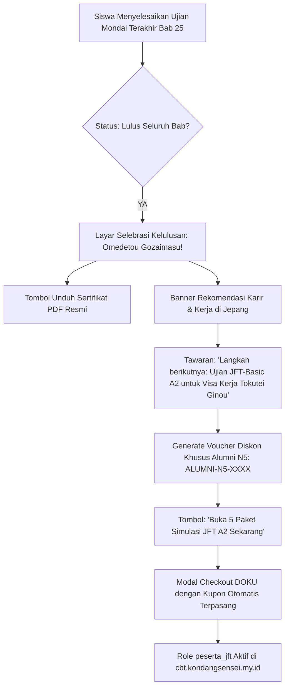

# Milestone 18: N5 Graduation Celebration Screen & JFT-A2 Cross-Selling Funnel

- **Milestone ID:** `M18`
- **File Name:** `m18-cross-selling-graduation-funnel.md`
- **Target Subdomain:** `kelas.kondangsensei.my.id`, `kondangsensei.my.id`
- **Primary Stakeholders:** Siswa N5 yang Lulus, Tim Marketing, Super Admin
- **Dependencies:** `M9` (Mondai Completion), `M11` (Certificate Generation), `M3` (DOKU Bundling)
- **Status:** Planned / Architecture Specification

---

## 1. Executive Summary & PRD Mapping
Berdasarkan PRD Seksi 1.1 (*Infrastructure Topology*) dan Seksi 3 Modul E.3 (*Cross-Selling & Lead Magnet Engine*):
Momen emosional tertinggi siswa adalah sesaat setelah dinyatakan lulus dari seluruh 25 Bab Ujian Mondai N5 dan menerima sertifikat digital.

Sistem memanfaatkan momen ini secara strategis dengan menampilkan **Layar Selebrasi Kelulusan Interaktif (Graduation Celebration Screen)** yang memuat:
1. Animasi selebrasi kelulusan interaktif (*Kanji Omedetou + Confetti*).
2. Spanduk **Cross-Selling Otomatis:** Tawaran eksklusif diskon paket simulasi ujian kerja Prometric JFT-Basic A2 di `cbt.kondangsensei.my.id`.
3. Generator kupon diskon dinamis (*One-Click Voucher Claim*) khusus alumni N5.

---

## 2. Funnel Flow & Cross-Selling Architecture



---

## 3. Data Schema & Voucher Tracking

```sql
CREATE TABLE graduation_cross_sells (
    id VARCHAR(36) PRIMARY KEY,
    user_id VARCHAR(36) NOT NULL,
    voucher_code VARCHAR(50) UNIQUE NOT NULL,
    discount_percentage INT DEFAULT 30, -- Diskon 30% khusus alumni N5
    target_package_id VARCHAR(36) NOT NULL,
    is_claimed BOOLEAN DEFAULT FALSE,
    claimed_at TIMESTAMP NULL,
    expired_at TIMESTAMP NOT NULL,
    created_at TIMESTAMP DEFAULT CURRENT_TIMESTAMP,
    FOREIGN KEY (user_id) REFERENCES users(id),
    FOREIGN KEY (target_package_id) REFERENCES packages(id)
);
```

---

## 4. UI/UX Specifications: Celebration & Offer Screen
- **Animasi Visual:**
  - Efek partikel bunga sakura (*cherry blossom petals falling*) dan konfeti emas berkilau.
  - Tulisan kaligrafi Jepang besar: `合格おめでとうございます！` (Selamat atas Kelulusan Anda!).
- **Spanduk Penawaran Cross-Selling:**
  - Kartu penawaran dengan batas waktu urgensi (*Countdown Timer Penawaran Terbatas 48 Jam*).
  - Teks persuasif berorientasi masa depan karir:
    > *"Kamu sudah menguasai dasar N5! Syarat utama untuk bekerja di Jepang lewat program Tokutei Ginou adalah lulus ujian JFT-Basic A2. Ambil paket simulasi Prometric resmi sekarang dengan diskon khusus alumni 30%!"*
  - Tombol CTA menonjol: `[ Klaim Diskon Alumni & Mulai Simulasi JFT A2 ]`.

---

## 5. Implementation Checklist & Acceptance Criteria
- [ ] Database migration tabel `graduation_cross_sells`.
- [ ] Komponen selebrasi React `GraduationCelebrationModal.tsx` dengan animasi sakura dan konfeti Canvas.
- [ ] Generator kode kupon otomatis alumni terikat ke user ID (`src/lib/voucherEngine.ts`).
- [ ] Integrasi parameter kupon langsung ke modal pembayaran DOKU (`M3`).
- [ ] Tracking konversi analitik: Mengukur persentase siswa alumni N5 yang mengonversi ke pembelian paket CBT JFT A2.
