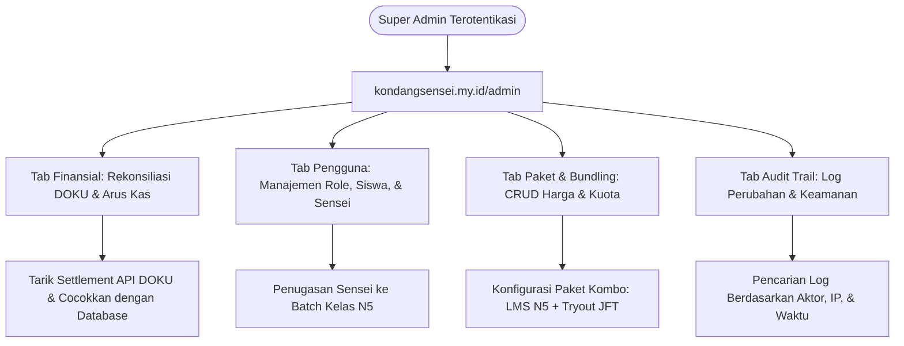

# Milestone 19: Super Admin Dashboard, Financial Reconciliation, & Ecosystem Audit Logs

- **Milestone ID:** `M19`
- **File Name:** `m19-super-admin-unified-reporting.md`
- **Target Subdomain:** `kondangsensei.my.id/admin` (Protected Super Admin Area)
- **Primary Stakeholders:** Super Admin, Direktur Operasional & Keuangan
- **Dependencies:** `M0`, `M1`, `M2`, `M3`, `M14`, `M17`
- **Status:** Planned / Architecture Specification

---

## 1. Executive Summary & PRD Mapping
Berdasarkan PRD Seksi 2.1 (*Super Admin Role & Access Control*) dan Seksi 4.1 (*Modul Administrator Backend*):
Super Admin memegang kendali tertinggi atas seluruh ekosistem KondangSensei, meliputi portal publik, platform kelas LMS N5, dan engine CBT JFT-Basic A2. 

Fungsi utama dasbor Super Admin:
1. **Laporan Keuangan Terpusat & Rekonsiliasi DOKU:** Memantau seluruh arus kas masuk dari QRIS, Virtual Account, dan E-Wallet serta mencocokkan status settlement DOKU API.
2. **Manajemen Paket & Bundling Engine:** Mengatur harga, masa aktif, dan kuota untuk paket satuan maupun paket kombo.
3. **Manajemen Pengguna & Hak Akses:** CRUD akun, penugasan Sensei ke kelas, reset password, dan pemantauan status langganan.
4. **Audit Logs & Keamanan:** Pencatatan log aktivitas kritis untuk mencegah kebocoran data atau kecurangan admin.

---

## 2. Super Admin Architecture & Ecosystem Telemetry



---

## 3. Data Schema & Audit Logging

```sql
CREATE TABLE audit_logs (
    id VARCHAR(36) PRIMARY KEY,
    actor_user_id VARCHAR(36) NOT NULL,
    actor_email VARCHAR(191) NOT NULL,
    ip_address VARCHAR(45) NOT NULL,
    user_agent TEXT NULL,
    action_type ENUM('user_create', 'role_change', 'payment_manual_verify', 'package_update', 'exam_delete', 'refund_issue') NOT NULL,
    target_resource_id VARCHAR(100) NOT NULL,
    details_json JSON NOT NULL,          -- Nilai sebelum (before) dan sesudah (after)
    created_at TIMESTAMP DEFAULT CURRENT_TIMESTAMP,
    FOREIGN KEY (actor_user_id) REFERENCES users(id)
);

CREATE TABLE financial_settlements (
    id VARCHAR(36) PRIMARY KEY,
    settlement_date DATE NOT NULL,
    total_gross_idr DECIMAL(14,2) NOT NULL,
    doku_fee_idr DECIMAL(12,2) NOT NULL,
    net_received_idr DECIMAL(14,2) NOT NULL,
    total_transactions_count INT NOT NULL,
    reconciliation_status ENUM('matched', 'discrepancy', 'pending') DEFAULT 'pending',
    notes TEXT NULL,
    created_at TIMESTAMP DEFAULT CURRENT_TIMESTAMP
);
```

---

## 4. UI/UX: Unified Executive Dashboard
1. **Executive Metric Cards (KPI Harian & Bulanan):**
   - 💰 **Total Pendapatan (Gross Revenue):** Ditampilkan dalam grafik time-series bulanan.
   - 👥 **Total Siswa Aktif:** Dibagi per modul (Siswa Kelas N5 vs Peserta CBT JFT).
   - 📈 **Rasio Kelulusan Siswa:** Tingkat kelulusan Ujian Mondai N5 dan Simulasi JFT-Basic A2.
   - ⚡ **Tingkat Konversi Lead Magnet:** Persentase peserta Mini Tryout gratis yang membeli paket berbayar.
2. **DOKU Financial Reconciliation Table:**
   - Pencarian berdasarkan nomor invoice (`INV-XXXX`).
   - Tombol "Sinkronkan dengan DOKU API" untuk mengecek transaksi yang belum terkonfirmasi oleh webhook otomatis.
3. **Class & Sensei Allocation Matrix:**
   - Panel untuk membuat batch kelas baru, membatasi kuota maksimal 10 siswa per batch, dan menugaskan Sensei penanggung jawab.

---

## 5. Security & Access Rules
- Proteksi route `/admin/*` dengan verifikasi ganda: session token harus memiliki klaim role `super_admin` dan IP address tervalidasi.
- Seluruh tindakan pengubahan data keuangan atau role wajib dicatat di tabel `audit_logs` secara permanen (*immutable log*).

---

## 6. Implementation Checklist & Acceptance Criteria
- [ ] Database migration tabel `audit_logs` dan `financial_settlements`.
- [ ] Implementasi layout dashboard Super Admin di `src/app/admin/layout.tsx`.
- [ ] Halaman analitik keuangan `/admin/finance` dengan chart pendapatan dan status DOKU.
- [ ] Halaman manajemen pengguna `/admin/users` dengan kemampuan assign role dan reset password.
- [ ] Halaman manajemen paket `/admin/packages` untuk konfigurasi harga paket satuan dan kombo bundling.
- [ ] Halaman audit log `/admin/audit-logs` dengan filter tanggal dan tipe aksi.
