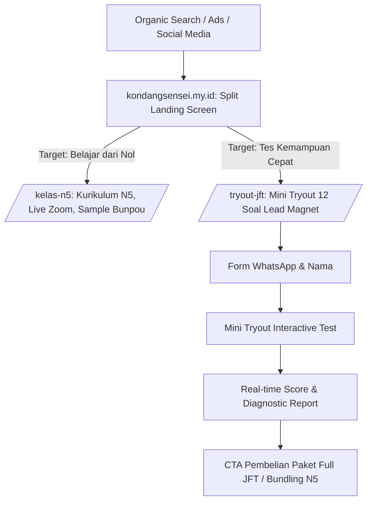

# Milestone 2: Main Portal, Split-Path Routing, & Mini Tryout Lead Magnet

- **Milestone ID:** `M2`
- **File Name:** `m2-portal-landing-lead-magnet.md`
- **Target Subdomain:** `kondangsensei.my.id` (Main Public Portal)
- **Primary Stakeholders:** Calon Siswa N5, Calon Peserta JFT, Tim Marketing & SEO
- **Dependencies:** `M0` (Shared Domain & Assets)
- **Status:** Planned / Architecture Specification

---

## 1. Executive Summary & PRD Mapping
Berdasarkan PRD Seksi 1.1 (*Main Portal & Split-Path Landing Page*) dan Seksi 3 Modul E.3 (*Cross-Selling & Lead Magnet Engine*):
Portal utama `kondangsensei.my.id` bertindak sebagai penyaring pengunjung cerdas (*traffic splitter*) dan mesin penangkap prospek (*lead generation*) dengan performa SEO tinggi. 

Dua jalur utama pengunjung:
1. **Jalur Pemula / Pelajar Dasar (`/kelas-n5`):** Menargetkan pencari kursus pemula, bimbel interaktif N5, kelas live Zoom, dan kurikulum tuntas.
2. **Jalur Ujian Cepat / Pekerja SSW (`/tryout-jft`):** Menargetkan calon peserta Tokutei Ginou / SSW yang membutuhkan simulasi Prometric JFT-Basic A2 dengan lead magnet **Mini Tryout Gratis 12 Soal**.

---

## 2. Information Architecture & SEO Strategy



### 2.1 Keyword Targeting & Metadata Architecture
- **Target Informasional:** "cara lulus jft basic a2", "contoh soal chokai jft", "tata bahasa n5 minna no nihongo", "pola kalimat n5".
- **Target Transaksional:** "tryout jft basic online", "simulasi prometric jft a2", "kursus n5 bersertifikat zoom".
- **Structured Data:** Schema.org `Course`, `EducationalOccupationalCredential`, dan `Quiz` JSON-LD tertanam di Next.js App Router metadata.

---

## 3. Lead Magnet: Mini Tryout 12 Soal Architecture

### 3.1 Komposisi Soal Mini Tryout
Mewakili 4 seksi standar JFT A2 secara proporsional:
1. **Moji & Goi (Huruf & Kosakata):** 3 Soal (Kanji N5, kosakata kata kerja/benda).
2. **Kaiwa (Percakapan):** 3 Soal (Pola ekspresi di tempat kerja/toko).
3. **Chōkai (Pendengaran):** 3 Soal (Audio dialog singkat + gambar opsi).
4. **Dokkai (Bacaan):** 3 Soal (Papan pengumuman/email singkat).

### 3.2 Data Capture Schema (`leads`)
```sql
CREATE TABLE leads (
    id VARCHAR(36) PRIMARY KEY,
    name VARCHAR(150) NOT NULL,
    whatsapp_number VARCHAR(20) NOT NULL,
    email VARCHAR(191) NULL,
    score INT NOT NULL,
    max_score INT DEFAULT 250,
    passing_grade INT DEFAULT 200,
    is_passed BOOLEAN NOT NULL,
    weakest_section VARCHAR(50) NOT NULL,
    utm_source VARCHAR(100) NULL,
    utm_campaign VARCHAR(100) NULL,
    converted_to_user_id VARCHAR(36) NULL,
    created_at TIMESTAMP DEFAULT CURRENT_TIMESTAMP
);
```

### 3.3 Diagnostic Report & Direct CTA Engine
Setelah pengerjaan 12 soal, peserta langsung disuguhkan:
1. **Skor Konversi:** `"Skor kamu: 175/250 (Belum Lulus - Standar Kelulusan 200)"`
2. **Analisis Kelemahan Real-time:** `"Kelemahan utama: Chōkai Section (Skor 33%)"`
3. **CTA Konversi Tertarget:**
   - `"Mau latihan soal full-length yang mirip ujian aslinya biar makin siap? Buka akses Paket Simulasi JFT-Basic A2 sekarang!"`
   - Integrasi tombol langsung ke modal checkout DOKU Payment.

---

## 4. UI/UX Specifications: `/kelas-n5`
- **Hero Section:** Value proposition "Kuasai Bahasa Jepang N5 Tanpa Bosan nonton Video pasif. Belajar dengan Blok Warna Interaktif & Live Zoom."
- **Interactive Bunpou Demo:** Widget interaktif kecil langsung di landing page yang memungkinkan pengunjung mencoba klik warna Bunpou sebelum mendaftar.
- **Tabel Perbandingan Flipped Classroom:** Metode Tradisional vs Ekosistem KondangSensei.
- **Social Proof & Testimoni:** Hasil kelulusan siswa dan bukti stempel Hanamaru dari Sensei.

---

## 5. Implementation Checklist & Acceptance Criteria
- [ ] Implementasi layout split-path di root `src/app/page.tsx` dengan pilihan visual N5 vs JFT A2 yang jelas.
- [ ] Halaman `/kelas-n5` dengan metadata SEO lengkap dan komponen interactive demo.
- [ ] Halaman `/tryout-jft` yang mengintegrasikan formulir WhatsApp, 12 soal interaktif, dan mesin penilaian.
- [ ] Endpoint backend `POST /api/leads` untuk menyimpan data prospek dan mengirim trigger notifikasi lead ke WhatsApp admin.
- [ ] Validasi Lighthouse Score SEO > 90 dan Mobile Performance > 85.
