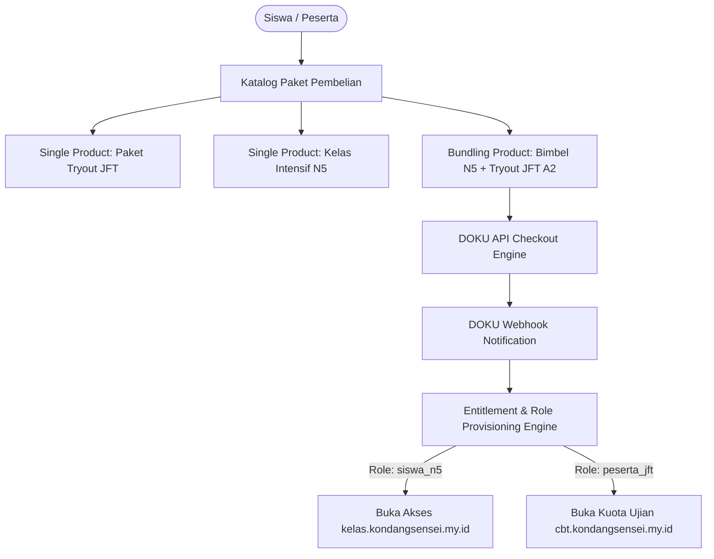

# Milestone 3: Centralized DOKU Payment Gateway & Multi-Product Bundling Engine

- **Milestone ID:** `M3`
- **File Name:** `m3-payment-gateway-bundling.md`
- **Target Subdomains:** `kondangsensei.my.id`, `cbt.kondangsensei.my.id`, `kelas.kondangsensei.my.id`
- **Primary Stakeholders:** Super Admin, Pembeli Paket (Siswa & Peserta)
- **Dependencies:** `M0` (Shared DB), `M1` (RBAC Roles)
- **Status:** Planned / Architecture Specification

---

## 1. Executive Summary & PRD Mapping
Berdasarkan PRD Seksi 2 (*Super Admin Controls*) dan Seksi 3 Modul E.1 (*Centralized Payment Gateway - DOKU Integration*):
KondangSensei membutuhkan sistem pembayaran terpusat yang aman menggunakan **DOKU Checkout API** (QRIS, Bank Transfer Virtual Account, dan E-Wallet) dengan **Bundling Engine** cerdas. Bundling Engine memungkinkan penciptaan paket kombo lintas produk, seperti:
`Paket Bimbel N5 Interaktif + 5x Voucher Simulasi JFT-Basic A2`.

---

## 2. Product Catalog & Bundling Architecture



### 2.1 Database Schema (`packages`, `bundle_items`, `transactions`, `entitlements`)
```sql
CREATE TABLE packages (
    id VARCHAR(36) PRIMARY KEY,
    name VARCHAR(150) NOT NULL,
    slug VARCHAR(150) UNIQUE NOT NULL,
    description TEXT,
    price DECIMAL(12,2) NOT NULL,
    original_price DECIMAL(12,2) NULL,
    is_bundle BOOLEAN DEFAULT FALSE,
    is_active BOOLEAN DEFAULT TRUE,
    created_at TIMESTAMP DEFAULT CURRENT_TIMESTAMP
);

-- Komponen dalam Paket Bundling
CREATE TABLE bundle_items (
    id VARCHAR(36) PRIMARY KEY,
    bundle_package_id VARCHAR(36) NOT NULL,
    target_module ENUM('lms_n5', 'cbt_jft') NOT NULL,
    access_duration_days INT NOT NULL, -- Contoh: 90 hari LMS, 60 hari CBT
    cbt_attempt_quota INT DEFAULT 0,    -- Contoh: 5 kali tryout JFT
    FOREIGN KEY (bundle_package_id) REFERENCES packages(id) ON DELETE CASCADE
);

CREATE TABLE transactions (
    id VARCHAR(36) PRIMARY KEY,
    invoice_number VARCHAR(100) UNIQUE NOT NULL,
    user_id VARCHAR(36) NOT NULL,
    package_id VARCHAR(36) NOT NULL,
    amount DECIMAL(12,2) NOT NULL,
    payment_method VARCHAR(50) NULL,
    doku_trans_id VARCHAR(100) NULL,
    payment_status ENUM('pending', 'paid', 'expired', 'failed') DEFAULT 'pending',
    paid_at TIMESTAMP NULL,
    expired_at TIMESTAMP NOT NULL,
    created_at TIMESTAMP DEFAULT CURRENT_TIMESTAMP,
    FOREIGN KEY (user_id) REFERENCES users(id),
    FOREIGN KEY (package_id) REFERENCES packages(id)
);

CREATE TABLE user_entitlements (
    id VARCHAR(36) PRIMARY KEY,
    user_id VARCHAR(36) NOT NULL,
    module ENUM('lms_n5', 'cbt_jft') NOT NULL,
    cbt_quota_remaining INT DEFAULT 0,
    valid_until DATETIME NOT NULL,
    transaction_id VARCHAR(36) NOT NULL,
    FOREIGN KEY (user_id) REFERENCES users(id),
    FOREIGN KEY (transaction_id) REFERENCES transactions(id)
);
```

---

## 3. DOKU API Integration Flow
1. **Inisialisasi Transaksi (`POST /api/payments/checkout`):**
   - Frontend memanggil API dengan `package_id`.
   - Backend memverifikasi harga resmi dari tabel `packages`.
   - Backend memanggil DOKU Generate Payment URL dengan menyertakan Invoice Number unik (`INV-YYYYMMDD-XXXX`), Client ID, Request-Id, Timestamp, dan HMAC-SHA256 Signature.
2. **DOKU Webhook Notification (`POST /api/payments/doku-webhook`):**
   - Endpoint publik menerima callback dari server DOKU.
   - **Validasi Signature DOKU:** Menghitung ulang SHA256 digest dari request header DOKU untuk mencegah invoice tampering.
   - Jika signature valid dan status pembayaran sukses:
     - Ubah status `transactions.payment_status` menjadi `paid`.
     - Jalankan `EntitlementProvisioningService`.
3. **Entitlement Provisioning Service:**
   - Memeriksa apakah paket adalah bundle atau single item.
   - Menambahkan role pengguna di tabel `user_roles`.
   - Menambahkan kuota CBT dan durasi masa aktif LMS di `user_entitlements`.
   - Mengirimkan email konfirmasi & invoice PDF otomatis ke pengguna.

---

## 4. UI Specifications: Multi-Package Checkout Modal
- Pilihan channel pembayaran DOKU: QRIS (GoPay, OVO, Dana, ShopeePay, BCA Mobile), Virtual Account (BCA, Mandiri, BNI, BRI), Kartu Kredit/Debit.
- Countdown waktu kedaluwarsa pembayaran (otomatis 24 jam untuk VA, 15 menit untuk QRIS dinamis).
- Auto-polling status pembayaran setiap 3 detik di modal pembayaran jika user belum menutup modal.

---

## 5. Implementation Checklist & Acceptance Criteria
- [ ] Database migration untuk tabel `packages`, `bundle_items`, `transactions`, dan `user_entitlements`.
- [ ] Implementasi DOKU Signature Generator di `src/lib/doku.ts` sesuai standar DOKU Checkout V2.
- [ ] Pembuatan API checkout `/api/payments/checkout` dan webhook handler `/api/payments/doku-webhook`.
- [ ] Otomatisasi pengaktifan role `siswa_n5` dan `peserta_jft` saat transaksi bundling dinyatakan `paid`.
- [ ] Unit testing simulasi webhook DOKU: pastikan validasi HMAC signature berjalan dan mencegah idempotency duplicate payment.
