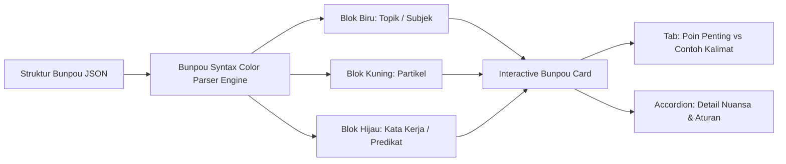

# Milestone 4: Zero-Video Bunpou Architecture & Color-Coded Grammar Block Engine

- **Milestone ID:** `M4`
- **File Name:** `m4-bunpou-color-coded-engine.md`
- **Target Subdomain:** `kelas.kondangsensei.my.id` (N5 LMS Platform)
- **Primary Stakeholders:** Siswa N5, Sensei (Live Presentation), Content Creator
- **Dependencies:** `M0` (Centralized DB), `M1` (RBAC)
- **Status:** Planned / Architecture Specification

---

## 1. Executive Summary & PRD Mapping
Berdasarkan PRD Seksi 3 Modul A.1 (*UI Tata Bahasa Bunpou Tersegmentasi*):
Platform LMS N5 KondangSensei menerapkan **Zero-Video Concept**. Penjelasan tata bahasa Minna no Nihongo / Irodori disajikan 100% interaktif tanpa video rekaman panjang yang pasif. 

Inti dari modul ini adalah **Color-Coded Block Engine**, yang membedah setiap struktur kalimat Jepang menjadi blok visual berwarna kontras:
- 🔵 **Topik Kalimat (Topic Marker / Subjek)**: Menyorot subjek dan partikel topik (seperti は `wa`, が `ga`).
- 🟡 **Partikel Kalimat (Particles)**: Menyorot partikel arah/objek/alat (seperti を `wo`, に `ni`, で `de`, へ `e`).
- 🟢 **Kata Kerja / Predikat (Verbs & Predicates)**: Menyorot kata kerja bentuk Kamus, Masu, Nai, Ta, atau Te-form.

---

## 2. Color-Coded Block Engine Architecture



### 2.1 Format Data JSON Soal Bunpou (`bunpou_modules`)
```json
{
  "chapter_id": 1,
  "pattern_code": "N5-B01-01",
  "title": "~ は ~ です (~ wa ~ desu)",
  "meaning": "A adalah B (Menyatakan identitas/keterangan subjek)",
  "formula_blocks": [
    { "type": "topic", "text": "KB 1 (Orang)", "subtext": "Subjek" },
    { "type": "particle", "text": "は (wa)", "subtext": "Partikel Topik" },
    { "type": "predicate", "text": "KB 2 (Profesi/Status) です", "subtext": "Predikat Kalimat" }
  ],
  "key_points": [
    "Partikel は ditulis dengan huruf Hiragana 'HA' tetapi dilafalkan 'WA'.",
    "Kata です (desu) berfungsi sebagai penutup kalimat sopan dan menyatakan penegasan positif saat ini."
  ],
  "example_sentences": [
    {
      "japanese": "わたし は gakusei です。",
      "furigana": [
        { "kanji": "わたし", "kana": "わたし", "type": "topic" },
        { "kanji": "は", "kana": "は (wa)", "type": "particle" },
        { "kanji": "学生", "kana": "がくせい", "type": "predicate" },
        { "kanji": "です", "kana": "です", "type": "predicate" }
      ],
      "romaji": "Watashi wa gakusei desu.",
      "indonesian": "Saya adalah seorang pelajar."
    }
  ],
  "nuance_accordion": {
    "title": "Perbedaan Sopan (です) vs Biasa (だ)",
    "content": "Bentuk 'desu' digunakan dalam situasi formal, kantor, dan berbicara dengan orang baru. Bentuk 'da' adalah ragam akrab (casual) yang hanya digunakan dengan teman sebaya atau keluarga."
  }
}
```

---

## 3. UI/UX Component Specifications

### 3.1 Design System & Color Tokens
- **Topik / Subjek (Topic Marker):**
  - Background: `bg-blue-50` (Dark: `bg-blue-950/40`)
  - Border: `border-blue-400`
  - Text: `text-blue-700` (Dark: `text-blue-300`)
  - Badge Label: `TOPIC`
- **Partikel (Particles):**
  - Background: `bg-amber-50` (Dark: `bg-amber-950/40`)
  - Border: `border-amber-400`
  - Text: `text-amber-800` (Dark: `text-amber-300`)
  - Badge Label: `PARTICLE`
- **Kata Kerja / Predikat (Verbs/Predicates):**
  - Background: `bg-emerald-50` (Dark: `bg-emerald-950/40`)
  - Border: `border-emerald-400`
  - Text: `text-emerald-800` (Dark: `text-emerald-300`)
  - Badge Label: `VERB / PREDICATE`

### 3.2 Interactive Features
1. **Interactive Hover / Click Tooltip:**
   Ketika siswa menyentuh atau mengarahkan kursor ke salah satu blok warna, muncul tooltip mikro yang menjelaskan fungsi gramatikal partikel atau perubahan bentuk kata kerja tersebut.
2. **Tab Switcher ("Poin Penting" vs "Contoh Kalimat"):**
   - Transisi animasi mulus (*fade & slide*).
   - Menyediakan audio player untuk mendengarkan lafal setiap contoh kalimat tanpa video.
3. **Accordion Element:**
   - Menyembunyikan catatan jebakan (*common mistakes*) atau perbandingan pola kalimat agar halaman tidak membuat siswa lelah membaca (*cognitive overload*).

---

## 4. Integration with Teacher Flipped Classroom
- Sesuai PRD Tahap 2 In-Class: Komponen Bunpou ini dirancang dengan mode **"Sensei Presentation Mode"** (tombol fullscreen tanpa menu sidebar navigasi), memungkinkan guru melakukan *screen sharing* di Zoom dengan tampilan teks yang besar, kontras, dan fokus.

---

## 5. Implementation Checklist & Acceptance Criteria
- [ ] Pembuatan skema database `bunpou_lessons` dan `bunpou_examples`.
- [ ] Komponen React `ColorCodedBlock.tsx` dengan varian styling topik (biru), partikel (kuning), dan predikat (hijau).
- [ ] Komponen tabulasi `BunpouTabSwitcher.tsx` (Poin Penting vs Contoh Kalimat).
- [ ] Komponen akordion `BunpouAccordion.tsx` untuk pendalaman materi/nuansa kalimat.
- [ ] Tombol audio instan di setiap kalimat contoh menggunakan HTML5 Audio API.
- [ ] Mode tampilan presentasi Sensei (*clean screen share mode*).
