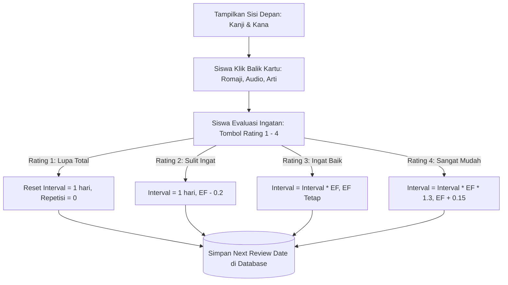

# Milestone 5: Kotoba Flashcards & Spaced Repetition System (SM-2 SRS Algorithm)

- **Milestone ID:** `M5`
- **File Name:** `m5-kotoba-flashcard-srs.md`
- **Target Subdomain:** `kelas.kondangsensei.my.id` (N5 LMS Platform)
- **Primary Stakeholders:** Siswa N5 (Pre-Class Preparation), Sensei (Memantau Retensi Kosakata)
- **Dependencies:** `M0` (Shared DB), `M1` (User Roles)
- **Status:** Planned / Architecture Specification

---

## 1. Executive Summary & PRD Mapping
Berdasarkan PRD Seksi 3 Modul A.2 (*Flashcard Kosakata Kotoba dengan SRS*) dan Modul C Tahap 1 (*Pre-Class Flipped Classroom*):
Modul Flashcard Kotoba dirancang untuk menghafal kosakata N5 secara efisien sebelum siswa memasuki kelas live Zoom. 

Karakteristik utama:
1. **Digital 3D Flip-Card:** Menampilkan Kanji & Furigana/Kana di sisi depan, serta Romaji, Audio pelafalan, dan Terjemahan Bahasa Indonesia di sisi belakang.
2. **Spaced Repetition System (SRS):** Mengadaptasi varian algoritma **SuperMemo-2 (SM-2)** yang secara dinamis menjadwalkan kartu untuk diulang 1 hari, 3 hari, atau 7 hari kemudian berdasarkan tingkat kesulitan evaluasi diri siswa.

---

## 2. Spaced Repetition Algorithm (SM-2 Variant) Specification



### 2.1 Formula Matematis SM-2
Untuk setiap kartu $i$ yang dipelajari siswa $u$:
- **Quality ($q$):** Skala 1 (Gagal), 2 (Sulit), 3 (Bagus), 4 (Sangat Mudah).
- **Easiness Factor ($EF$):** Default awal $2.5$.
  $$EF' = EF + (0.1 - (4 - q) \times (0.08 + (4 - q) \times 0.02))$$
  *(Batas minimum $EF$ adalah $1.3$)*.
- **Interval ($I$ dalam hari):**
  - Jika $q < 2$ (Gagal/Lupa): $I = 1$, Repetisi $n = 0$.
  - Jika $n = 1$: $I = 1$ hari.
  - Jika $n = 2$: $I = 3$ hari.
  - Jika $n > 2$: $I_n = I_{n-1} \times EF'$.
- **`next_review_at`:** Dihitung sebagai $\text{Waktu\_Sekarang} + I \times 24 \text{ jam}$.

---

## 3. Database Schema (`vocabularies`, `user_vocab_srs`)

```sql
CREATE TABLE vocabularies (
    id VARCHAR(36) PRIMARY KEY,
    chapter_id INT NOT NULL,
    kanji VARCHAR(50) NULL,
    kana VARCHAR(50) NOT NULL,
    romaji VARCHAR(50) NOT NULL,
    indonesian_meaning TEXT NOT NULL,
    word_type ENUM('noun', 'verb_group_1', 'verb_group_2', 'verb_group_3', 'i_adj', 'na_adj', 'adverb', 'particle'),
    audio_url VARCHAR(255) NULL,
    example_sentence_jp TEXT NULL,
    example_sentence_id TEXT NULL,
    created_at TIMESTAMP DEFAULT CURRENT_TIMESTAMP
);

CREATE TABLE user_vocab_srs (
    id VARCHAR(36) PRIMARY KEY,
    user_id VARCHAR(36) NOT NULL,
    vocab_id VARCHAR(36) NOT NULL,
    easiness_factor DECIMAL(4,2) DEFAULT 2.50,
    repetition_count INT DEFAULT 0,
    interval_days INT DEFAULT 0,
    last_quality_rating INT NULL,
    next_review_at DATETIME NOT NULL,
    last_reviewed_at DATETIME NULL,
    FOREIGN KEY (user_id) REFERENCES users(id) ON DELETE CASCADE,
    FOREIGN KEY (vocab_id) REFERENCES vocabularies(id) ON DELETE CASCADE,
    UNIQUE(user_id, vocab_id)
);
```

---

## 4. UI/UX Interaction & Audio Integration
1. **Animasi 3D Flip Card:**
   - Animasi CSS `transform: rotateY(180deg)` dengan `perspective: 1000px` dan `transition: transform 0.4s ease`.
   - Tombol shortcut keyboard (Spasi untuk membalik kartu, angka 1-4 untuk memilih rating ingatan).
2. **In-Browser Audio Player:**
   - Tombol ikon speaker di sisi depan dan belakang kartu.
   - Menggunakan file MP3 lafal penutur asli (*native speaker*) dengan fallback Web Speech API (`SpeechSynthesisUtterance('ja-JP')`).
3. **SRS Queue Counter Bar:**
   - Menampilkan 3 lencana counter di bagian atas:
     - 🔴 **Belum Hafal / Ulangi Hari Ini:** $N$ kartu
     - 🟡 **Sedang Dipelajari:** $M$ kartu
     - 🟢 **Sudah Dikuasai:** $K$ kartu

---

## 5. Implementation Checklist & Acceptance Criteria
- [ ] Database migration untuk tabel `vocabularies` dan `user_vocab_srs`.
- [ ] Implementasi algoritma SM-2 kalkulator di `src/lib/srsAlgorithm.ts`.
- [ ] Endpoint `GET /api/srs/deck?chapter_id=X` (mengambil kartu dengan `next_review_at <= NOW()`).
- [ ] Endpoint `POST /api/srs/review` (menerima rating 1-4, menghitung $EF'$ dan interval baru, menyimpan hasil).
- [ ] Komponen React `FlashcardDeck.tsx` dengan flip kartu 3D dan audio native.
- [ ] Integrasi tombol pelafalan suara dan navigasi keyboard responsif di smartphone.
