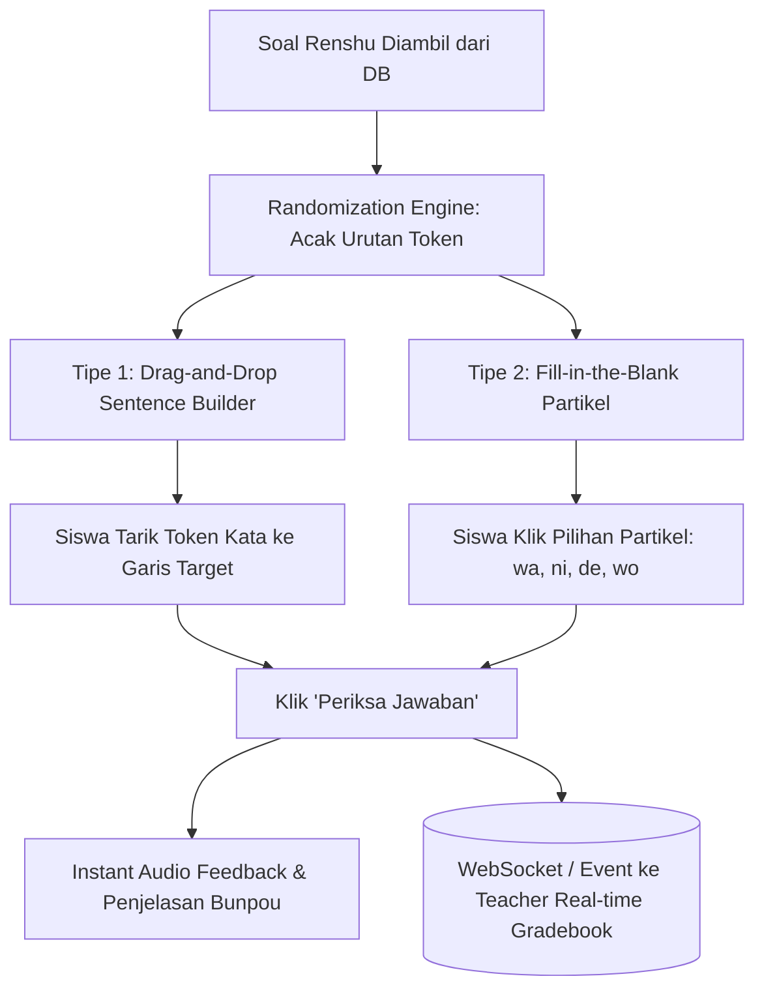

# Milestone 6: Dynamic Renshu Engine (Drag-and-Drop Sentence Builder & Fill-in-Blank)

- **Milestone ID:** `M6`
- **File Name:** `m6-renshu-dynamic-practice.md`
- **Target Subdomain:** `kelas.kondangsensei.my.id` (N5 LMS Platform)
- **Primary Stakeholders:** Siswa N5, Sensei (Live In-Class Practice & Review)
- **Dependencies:** `M0` (Shared DB), `M4` (Bunpou Structure)
- **Status:** Planned / Architecture Specification

---

## 1. Executive Summary & PRD Mapping
Berdasarkan PRD Seksi 3 Modul A.3 (*Latihan Soal Dinamis Renshu*) dan Modul C Tahap 2 (*Praktek Renshu Bersama In-Class*):
Modul Renshu merupakan latihan formatif aktif yang dikerjakan siswa secara interaktif mandiri maupun simultan saat kelas Zoom berlangsung. 

Fitur utama:
1. **Drag-and-Drop Sentence Builder:** Siswa menyusun kepingan kata/partikel acak menjadi kalimat gramatikal yang valid.
2. **Fill-in-the-Blank Particle Selector:** Siswa memilih atau mengetik partikel yang tepat untuk melengkapi rumpang kalimat.
3. **Randomization Engine:** Pengacakan urutan soal dan token opsi jawaban per sesi pengerjaan agar siswa tidak sekadar menghafal letak tombol.
4. **Real-time Live Sync Hook:** Nilai dan jawaban yang disubmit langsung dikirim ke Teacher Gradebook (M14).

---

## 2. Interaction Mechanisms & Question Types



### 2.1 Drag-and-Drop Sentence Builder Engine
- **Mekanisme:**
  - Kalimat target: `わたし は としょかん で ほん を よみます。`
  - Sistem memecah kalimat menjadi token acak: `[ ほん を ]`, `[ わたし は ]`, `[ よみます ]`, `[ としょかん で ]`.
  - Siswa menyeret (*drag*) atau menyentuh (*tap-to-place*) kepingan ke kotak slot kalimat.
  - Mendukung penyusunan ulang (*reorder*) dengan sentuhan di layar smartphone (*touch-friendly* via HTML5 Drag/Drop atau library seperti `@dnd-kit`).

### 2.2 Fill-in-the-Blank Particle Selector
- **Mekanisme:**
  - Soal: `ぎんこう ( [ ? ] ) なんじ まで ですか。`
  - Pilihan partikel: `[ は ]`, `[ に ]`, `[ から ]`, `[ で ]`.
  - Siswa memilih satu partikel yang paling tepat sesuai konteks kalimat.

---

## 3. Data Schema (`renshu_questions`, `renshu_submissions`)

```sql
CREATE TABLE renshu_questions (
    id VARCHAR(36) PRIMARY KEY,
    chapter_id INT NOT NULL,
    question_type ENUM('drag_drop', 'fill_blank') NOT NULL,
    prompt_text TEXT NOT NULL,           -- Contoh arti: "Saya membaca buku di perpustakaan."
    correct_tokens JSON NOT NULL,        -- Array terurut: ["わたし は", "としょかん で", "ほん を", "よみます"]
    distractor_tokens JSON NULL,         -- Token pengecoh tambahan opsional
    target_sentence_jp VARCHAR(255) NOT NULL,
    explanation TEXT NOT NULL,           -- Pembahasan tata bahasa jika salah
    difficulty_level INT DEFAULT 1,
    created_at TIMESTAMP DEFAULT CURRENT_TIMESTAMP
);

CREATE TABLE renshu_submissions (
    id VARCHAR(36) PRIMARY KEY,
    user_id VARCHAR(36) NOT NULL,
    question_id VARCHAR(36) NOT NULL,
    class_id VARCHAR(36) NULL,           -- Menandai jika dikerjakan saat sesi kelas live
    submitted_tokens JSON NOT NULL,
    is_correct BOOLEAN NOT NULL,
    attempt_count INT DEFAULT 1,
    created_at TIMESTAMP DEFAULT CURRENT_TIMESTAMP,
    FOREIGN KEY (user_id) REFERENCES users(id),
    FOREIGN KEY (question_id) REFERENCES renshu_questions(id)
);
```

---

## 4. Randomization & Validation Algorithm
1. **Token Shuffling (Fisher-Yates Algorithm):**
   Setiap kali latihan dimuat, token jawaban benar digabung dengan token pengecoh (jika ada) lalu diacak menggunakan algoritma Fisher-Yates dengan seed dinamis.
2. **Flexible Sentence Order:**
   Dalam bahasa Jepang, urutan keterangan waktu dan tempat seringkali fleksibel (misal: `わたし は としょかん で ほん を よみます` setara dengan `としょかん で わたし は ほん を よみます`). Validator mendukung multi-valid sentence permutations yang didefinisikan dalam JSON `valid_permutations`.

---

## 5. Implementation Checklist & Acceptance Criteria
- [ ] Database migration tabel `renshu_questions` dan `renshu_submissions`.
- [ ] Komponen drag-and-drop React `SentenceBuilder.tsx` mendukung touch event smartphone dan mouse desktop.
- [ ] Komponen pilihan rumpang partikel `FillInParticle.tsx`.
- [ ] Efek suara interaktif (*audio chime* saat benar, *soft thud* saat salah) dengan tombol toggle suara on/off.
- [ ] Event dispatch saat pengerjaan selesai untuk integrasi ke Real-time Gradebook Teacher (M14).
- [ ] Unit testing: Validasi permutasi urutan kalimat gramatikal yang diizinkan.
