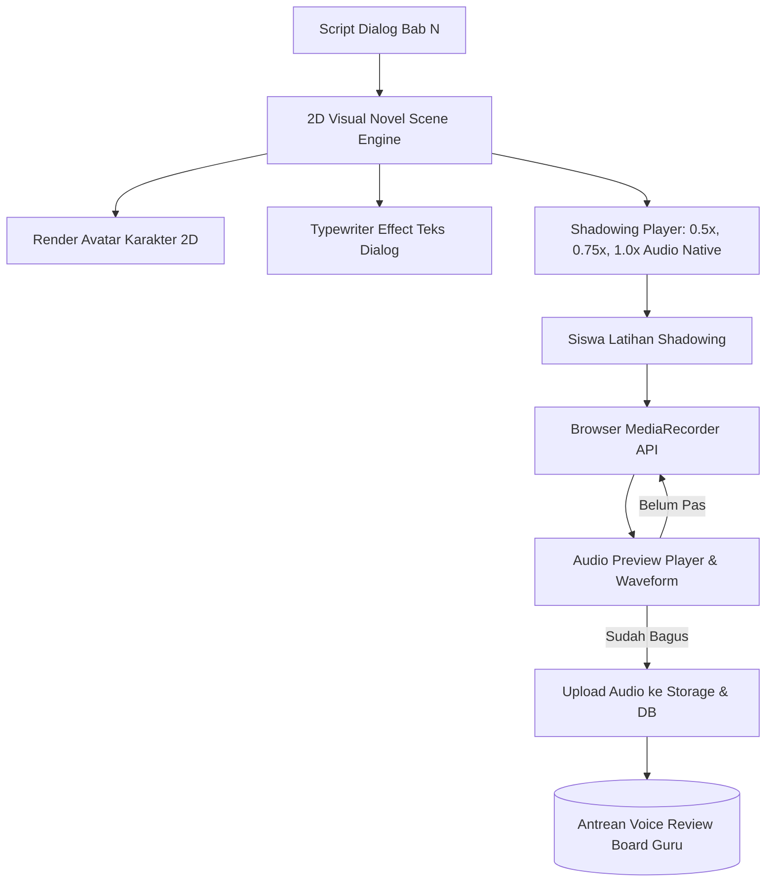

# Milestone 7: 2D Kaiwa Visual Novel, Shadowing Player, & MediaRecorder Audio Submission

- **Milestone ID:** `M7`
- **File Name:** `m7-kaiwa-visual-novel-shadowing.md`
- **Target Subdomain:** `kelas.kondangsensei.my.id` (N5 LMS Platform)
- **Primary Stakeholders:** Siswa N5, Sensei (Live Class Reader & Audio Evaluator)
- **Dependencies:** `M0` (Shared DB), `M1` (User Roles)
- **Status:** Planned / Architecture Specification

---

## 1. Executive Summary & PRD Mapping
Berdasarkan PRD Seksi 3 Modul A.4 (*Praktek Percakapan Kaiwa Visual Novel*), Modul C (*Flipped Classroom Workflow*), dan Modul D.3 (*Voice Review Board*):
Modul Kaiwa menyajikan percakapan bahasa Jepang dalam antarmuka imersif bergaya **2D Visual Novel (VN)** dengan efek teks *typewriter*. 

Fitur teknis utama:
1. **Visual Novel UI:** Karakter 2D dengan ekspresi wajah kontekstual dan kotak dialog teks mengalir (*streaming typewriter*).
2. **Shadowing Player:** Pemutar audio percakapan dengan pengatur kecepatan tempo pemutaran (**0.5x, 0.75x, 1.0x**) untuk melatih ketepatan intonasi (*pitch accent*).
3. **In-Browser Audio Recorder (`MediaRecorder API`):** Siswa merekam suara lafal kalimat dialog secara langsung dari peramban tanpa aplikasi pihak ketiga, dapat mendengarkan pratinjau (*preview*), merekam ulang (*re-record*), dan mengirim audio ke server.

---

## 2. Visual Novel & Audio Recording Architecture



---

## 3. Data Schema & Dialogue Script Structure

### 3.1 Skema Dialog (`kaiwa_scenes`, `kaiwa_lines`, `kaiwa_voice_submissions`)
```sql
CREATE TABLE kaiwa_scenes (
    id VARCHAR(36) PRIMARY KEY,
    chapter_id INT NOT NULL,
    scene_title VARCHAR(150) NOT NULL,
    setting_background_url VARCHAR(255) NOT NULL,
    situation_description TEXT NOT NULL,
    created_at TIMESTAMP DEFAULT CURRENT_TIMESTAMP
);

CREATE TABLE kaiwa_lines (
    id VARCHAR(36) PRIMARY KEY,
    scene_id VARCHAR(36) NOT NULL,
    line_order INT NOT NULL,
    speaker_name VARCHAR(50) NOT NULL,
    character_avatar_url VARCHAR(255) NOT NULL,
    character_position ENUM('left', 'right') DEFAULT 'left',
    japanese_text TEXT NOT NULL,
    furigana_json JSON NOT NULL,
    romaji TEXT NOT NULL,
    indonesian_translation TEXT NOT NULL,
    audio_url VARCHAR(255) NOT NULL,
    is_student_role BOOLEAN DEFAULT FALSE, -- Ditandai jika giliran siswa yang harus membaca/merekam
    FOREIGN KEY (scene_id) REFERENCES kaiwa_scenes(id) ON DELETE CASCADE
);

CREATE TABLE kaiwa_voice_submissions (
    id VARCHAR(36) PRIMARY KEY,
    user_id VARCHAR(36) NOT NULL,
    line_id VARCHAR(36) NOT NULL,
    audio_file_url VARCHAR(255) NOT NULL,
    audio_duration_seconds DECIMAL(5,2) NOT NULL,
    review_status ENUM('pending', 'approved', 'revision_needed') DEFAULT 'pending',
    sensei_feedback_audio_url VARCHAR(255) NULL,
    sensei_feedback_text TEXT NULL,
    hanamaru_awarded BOOLEAN DEFAULT FALSE,
    submitted_at TIMESTAMP DEFAULT CURRENT_TIMESTAMP,
    FOREIGN KEY (user_id) REFERENCES users(id),
    FOREIGN KEY (line_id) REFERENCES kaiwa_lines(id)
);
```

---

## 4. Technical Implementation: Shadowing Player & MediaRecorder

### 4.1 Shadowing Player Playback Rate Control
Menggunakan HTML5 Audio API:
```typescript
const audioRef = useRef<HTMLAudioElement | null>(null);

const setPlaybackSpeed = (speed: 0.5 | 0.75 | 1.0) => {
  if (audioRef.current) {
    audioRef.current.playbackRate = speed;
  }
};
```
- **0.5x:** Untuk menganalisis partikel cepat dan akhiran suku kata.
- **0.75x:** Kecepatan ideal transisi pembelajar pemula.
- **1.0x:** Kecepatan penutur asli Jepang normal.

### 4.2 In-Browser MediaRecorder Pipeline
```typescript
// Merekam dalam format audio/webm (fallback audio/mp4 pada Safari/iOS)
const startRecording = async () => {
  const stream = await navigator.mediaDevices.getUserMedia({ audio: true });
  const mimeType = MediaRecorder.isTypeSupported("audio/webm;codecs=opus") 
    ? "audio/webm;codecs=opus" 
    : "audio/mp4";
  const recorder = new MediaRecorder(stream, { mimeType });
  // Buffer chunks -> Blob -> Preview URL
};
```
- Validasi ukuran file di browser (maksimal 5 MB per rekaman dialog).
- Endpoint upload: `POST /api/kaiwa/submit-voice` (disimpan ke storage MinIO / S3 / local public uploads terenkripsi).

---

## 5. UI/UX Specifications
- **Visual Novel Canvas:** Rasio aspek responsif 16:9, karakter 2D dengan transisi slide halus saat pergantian giliran bicara.
- **Typewriter Effect:** Kecepatan teks 30 milidetik per karakter dengan tombol "Lewati" (*Skip Typewriter*).
- **Voice Waveform Indicator:** Visualisasi animasi gelombang audio saat siswa sedang berbicara ke mikrofon.

---

## 6. Implementation Checklist & Acceptance Criteria
- [ ] Database migration untuk tabel `kaiwa_scenes`, `kaiwa_lines`, dan `kaiwa_voice_submissions`.
- [ ] Komponen Visual Novel `VisualNovelBox.tsx` dengan typewriter effect dan avatar karakter.
- [ ] Komponen `ShadowingPlayer.tsx` dengan pengatur kecepatan 0.5x, 0.75x, dan 1.0x.
- [ ] Komponen audio recorder `InBrowserAudioRecorder.tsx` berbasis `MediaRecorder API` dengan waveform indikator.
- [ ] Endpoint backend untuk upload file suara siswa dan pencatatan riwayat penugasan.
- [ ] Verifikasi audio playback dan recording di browser mobile Chrome Android dan Safari iOS.
