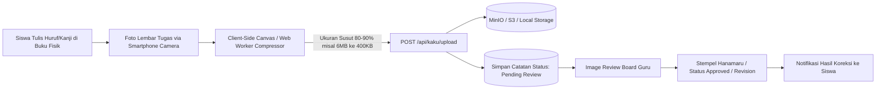

# Milestone 8: Kaku Assignment Pipeline, Client-Side Image Compression, & Submission Tracking

- **Milestone ID:** `M8`
- **File Name:** `m8-kaku-digital-homework.md`
- **Target Subdomain:** `kelas.kondangsensei.my.id` (N5 LMS Platform)
- **Primary Stakeholders:** Siswa N5, Sensei (Image Reviewer)
- **Dependencies:** `M0` (Shared DB), `M1` (User Roles)
- **Status:** Planned / Architecture Specification

---

## 1. Executive Summary & PRD Mapping
Berdasarkan PRD Seksi 3 Modul A.5 (*Buku PR Digital Kaku*), Modul C Tahap 2 (*Sesi Kaku In-Class*), dan Modul D.3 (*Image Review Board*):
Modul Kaku merevolusi penugasan menulis huruf Jepang (Hiragana, Katakana, dan Kanji N5) dengan menjembatani latihan motorik fisik dan efisiensi pelaporan digital (**Physical-to-Digital Assignment**). 

Siswa menulis di buku kotak-kotak fisik (*Genkouyoushi* / buku tulis bergaris), memfoto lembar hasil tulisannya melalui kamera smartphone, lalu mengunggahnya ke platform. Sistem menerapkan **kompresi gambar otomatis di sisi klien (Client-side Image Compressor)** sebelum upload untuk menghemat bandwidth pengguna dan storage server.

---

## 2. Physical-to-Digital Architecture & Upload Pipeline



---

## 3. Client-Side Image Compressor Algorithm
Foto dari kamera ponsel beresolusi tinggi (biasanya 5–15 MB) sangat lambat diunggah oleh siswa di daerah dengan sinyal terbatas dan membebani server storage.

### 3.1 Spesifikasi Kompresi di Browser
- **Maksimum Dimensi:** 1920 x 1080 px (mempertahankan rasio aspek dan ketajaman coretan tinta/pensil).
- **Format Target:** `image/webp` (fallback `image/jpeg`).
- **Target Quality:** `0.82` (Kualitas visual tulisan tetap tajam dan terbaca jelas oleh Sensei).
- **Implementasi:** HTML5 Canvas rendering & `OffscreenCanvas` / Web Worker agar UI tidak macet (*no UI freeze*).

```typescript
// Pseudocode kompresi klien
export async function compressHomeworkImage(file: File): Promise<Blob> {
  return new Promise((resolve) => {
    const reader = new FileReader();
    reader.onload = (e) => {
      const img = new Image();
      img.onload = () => {
        const canvas = document.createElement("canvas");
        const ctx = canvas.getContext("2d");
        const maxDim = 1920;
        let { width, height } = img;

        if (width > maxDim || height > maxDim) {
          if (width > height) {
            height = (height * maxDim) / width;
            width = maxDim;
          } else {
            width = (width * maxDim) / height;
            height = maxDim;
          }
        }

        canvas.width = width;
        canvas.height = height;
        ctx?.drawImage(img, 0, 0, width, height);

        canvas.toBlob(
          (blob) => resolve(blob!),
          "image/webp",
          0.82
        );
      };
      img.src = e.target?.result as string;
    };
    reader.readAsDataURL(file);
  });
}
```

---

## 4. Database Schema (`kaku_assignments`, `kaku_submissions`)

```sql
CREATE TABLE kaku_assignments (
    id VARCHAR(36) PRIMARY KEY,
    chapter_id INT NOT NULL,
    title VARCHAR(150) NOT NULL,
    instructions TEXT NOT NULL,
    sample_sheet_pdf_url VARCHAR(255) NULL, -- Template lembar kotak-kotak yang dapat dicetak
    due_date DATETIME NULL,
    created_at TIMESTAMP DEFAULT CURRENT_TIMESTAMP
);

CREATE TABLE kaku_submissions (
    id VARCHAR(36) PRIMARY KEY,
    assignment_id VARCHAR(36) NOT NULL,
    user_id VARCHAR(36) NOT NULL,
    class_id VARCHAR(36) NULL,
    image_url VARCHAR(255) NOT NULL,
    compressed_size_kb INT NOT NULL,
    original_size_kb INT NOT NULL,
    status ENUM('pending', 'approved', 'revision_needed') DEFAULT 'pending',
    sensei_notes TEXT NULL,
    hanamaru_awarded BOOLEAN DEFAULT FALSE,
    reviewed_by VARCHAR(36) NULL,
    reviewed_at TIMESTAMP NULL,
    submitted_at TIMESTAMP DEFAULT CURRENT_TIMESTAMP,
    FOREIGN KEY (assignment_id) REFERENCES kaku_assignments(id),
    FOREIGN KEY (user_id) REFERENCES users(id),
    FOREIGN KEY (reviewed_by) REFERENCES users(id)
);
```

---

## 5. UI/UX Interaction & Status Tracking
1. **Layar Pengumpulan Tugas Siswa:**
   - Tombol "Ambil Foto Sekarang" (memicu kamera belakang ponsel dengan atribut `capture="environment"`).
   - Indikator progres kompresi (*Progress Bar: "Mengoptimalkan ukuran foto tulisan..."*).
   - Pratinjau foto sebelum klik "Kirim Tugas".
2. **Lencana Status Pengerjaan (Status Badges):**
   - 🟡 **Pending Review:** Tugas telah terkirim dan menunggu giliran koreksi Sensei.
   - 🟢 **Approved:** Tugas diterima dengan nilai baik dan telah diberi stempel apresiasi.
   - 🔴 **Revision Needed:** Goresan huruf/urutan goresan (*kakijun*) salah. Siswa wajib mengunggah foto perbaikan.

---

## 6. Implementation Checklist & Acceptance Criteria
- [ ] Database migration tabel `kaku_assignments` dan `kaku_submissions`.
- [ ] Utilitas kompresi klien `src/lib/imageCompressor.ts` dengan kompresi WebP tajam dan performa tinggi.
- [ ] Komponen unggah foto `KakuUploadModal.tsx` dengan integrasi kamera smartphone dan pratinjau.
- [ ] Endpoint backend `POST /api/kaku/submit` dengan validasi mime type gambar dan sanitasi file.
- [ ] Tampilan status riwayat penugasan Kaku di dashboard siswa.
- [ ] Pengujian unggah foto 10 MB dari smartphone -> Ukuran terunggah < 600 KB tanpa kehilangan detail coretan pensil.
