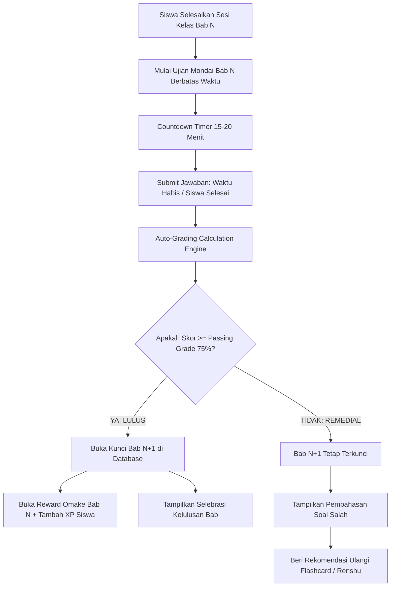

# Milestone 9: Timed Mondai Test Engine, Auto-Grading, & Prerequisite Bab Gating

- **Milestone ID:** `M9`
- **File Name:** `m9-mondai-evaluation-gating.md`
- **Target Subdomain:** `kelas.kondangsensei.my.id` (N5 LMS Platform)
- **Primary Stakeholders:** Siswa N5, Sensei, Curriculum Director
- **Dependencies:** `M0` (Shared DB), `M1` (User Roles)
- **Status:** Planned / Architecture Specification

---

## 1. Executive Summary & PRD Mapping
Berdasarkan PRD Seksi 3 Modul A.6 (*Ujian Evaluasi Mondai & System Gating*) dan Modul C Tahap 3 (*Post-Class Evaluation*):
Modul Mondai merupakan ujian evaluasi akhir bab berbatas waktu (*timed test engine*) yang wajib diselesaikan siswa setelah mempelajari materi Bunpou, Kotoba, Renshu, dan Kaiwa.

Dua pilar utama:
1. **Auto-Grading & Instant Result:** Penilaian otomatis dalam hitungan detik dengan kalkulasi persentase dan penentuan kelulusan (*Pass/Fail*).
2. **System Gating (Bab Lock Mechanism):** Materi Bab berikutnya (**Bab N+1**) terkunci penuh (*locked*) sampai siswa berhasil mencapai nilai ambang batas kelulusan (*Passing Grade*, default: **75%**) di ujian Mondai bab saat ini.

---

## 2. System Gating & Progression Architecture



---

## 3. Data Schema & Gating Tables

### 3.1 Skema Mondai & User Progress (`mondai_tests`, `mondai_questions`, `user_chapter_progress`)
```sql
CREATE TABLE mondai_tests (
    id VARCHAR(36) PRIMARY KEY,
    chapter_id INT UNIQUE NOT NULL,
    title VARCHAR(150) NOT NULL,
    duration_minutes INT DEFAULT 20,
    passing_grade_percent INT DEFAULT 75,
    total_questions INT NOT NULL,
    created_at TIMESTAMP DEFAULT CURRENT_TIMESTAMP
);

CREATE TABLE mondai_questions (
    id VARCHAR(36) PRIMARY KEY,
    test_id VARCHAR(36) NOT NULL,
    question_number INT NOT NULL,
    question_text TEXT NOT NULL,
    image_url VARCHAR(255) NULL,
    audio_url VARCHAR(255) NULL,
    options_json JSON NOT NULL,          -- Array opsi: [{"id": "A", "text": "..."}, {"id": "B", "text": "..."}]
    correct_option_id VARCHAR(10) NOT NULL,
    explanation_text TEXT NOT NULL,
    FOREIGN KEY (test_id) REFERENCES mondai_tests(id) ON DELETE CASCADE
);

CREATE TABLE user_chapter_progress (
    id VARCHAR(36) PRIMARY KEY,
    user_id VARCHAR(36) NOT NULL,
    chapter_id INT NOT NULL,
    is_unlocked BOOLEAN DEFAULT FALSE,
    is_completed BOOLEAN DEFAULT FALSE,
    highest_score DECIMAL(5,2) DEFAULT 0.00,
    attempts_count INT DEFAULT 0,
    unlocked_at TIMESTAMP NULL,
    completed_at TIMESTAMP NULL,
    FOREIGN KEY (user_id) REFERENCES users(id),
    UNIQUE(user_id, chapter_id)
);

CREATE TABLE mondai_test_attempts (
    id VARCHAR(36) PRIMARY KEY,
    user_id VARCHAR(36) NOT NULL,
    test_id VARCHAR(36) NOT NULL,
    score_percent DECIMAL(5,2) NOT NULL,
    is_passed BOOLEAN NOT NULL,
    answers_payload JSON NOT NULL,
    started_at DATETIME NOT NULL,
    finished_at DATETIME NOT NULL,
    FOREIGN KEY (user_id) REFERENCES users(id),
    FOREIGN KEY (test_id) REFERENCES mondai_tests(id)
);
```

---

## 4. Timed Test Engine & Gating Logic

### 4.1 Server-Enforced Countdown Timer
- Waktu ujian dicatat di sisi server saat siswa memulai tes (`started_at`).
- Saat frontend mengirim payload jawaban:
  $$\text{Durasi} = \text{finished\_at} - \text{started\_at}$$
  Jika melampaui batas waktu toleransi (durasi + 60 detik toleransi latency jaringan), sistem otomatis menolak jawaban yang belum disubmit dan hanya menghitung jawaban yang tersimpan sebelum waktu habis.

### 4.2 Gating Verification Middleware / Route Guard
Ketika siswa mencoba membuka rute materi Bab N+1 (`/materi/bab-2`):
```typescript
export async function assertChapterAccess(userId: string, chapterId: number) {
  if (chapterId === 1) return true; // Bab 1 selalu terbuka secara default

  const prevChapterProgress = await db.userChapterProgress.findUnique({
    where: { userId_chapterId: { userId, chapterId: chapterId - 1 } }
  });

  if (!prevChapterProgress || !prevChapterProgress.isCompleted) {
    throw new GatedContentError(
      `Bab ${chapterId} masih terkunci! Anda wajib lulus Ujian Mondai Bab ${chapterId - 1} terlebih dahulu.`
    );
  }
  return true;
}
```

---

## 5. UI/UX Specifications
- **Layar Ujian Mondai:** Tampilan bersih (*distraction-free mode*), panel nomor soal dengan indikator warna (sudah dijawab / belum dijawab / ragu-ragu), dan countdown timer mencolok dengan peringatan warna merah saat waktu tersisa < 3 menit.
- **Layar Rapor Kelulusan:**
  - Jika Lulus: Efek animasi konfeti, lencana *LULUS*, pembukaan kunci Bab berikutnya secara visual (*padlock unlock animation*), serta tautan langsung ke Reward Omake.
  - Jika Belum Lulus: Grafik evaluasi kesalahan per jenis soal, saran materi yang perlu diulang, dan tombol "Coba Lagi" (remedial).

---

## 6. Implementation Checklist & Acceptance Criteria
- [ ] Database migration tabel `mondai_tests`, `mondai_questions`, `user_chapter_progress`, dan `mondai_test_attempts`.
- [ ] Implementasi countdown timer presisi di `MondaiExamEngine.tsx` dengan auto-submit saat waktu habis.
- [ ] Endpoint `POST /api/mondai/submit` dengan kalkulasi nilai otomatis dan trigger update `user_chapter_progress`.
- [ ] Gating middleware untuk memproteksi akses seluruh rute materi Bab N+1.
- [ ] Tampilan kunci gembok (*locked badge*) pada silabus di dashboard siswa.
- [ ] Unit testing: Pastikan siswa dengan nilai 74% tetap terkunci dari Bab N+1, dan siswa dengan nilai 75% berhasil membuka Bab N+1.
